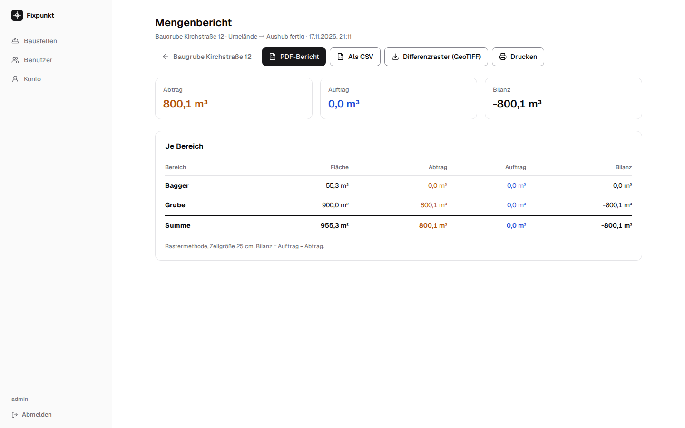
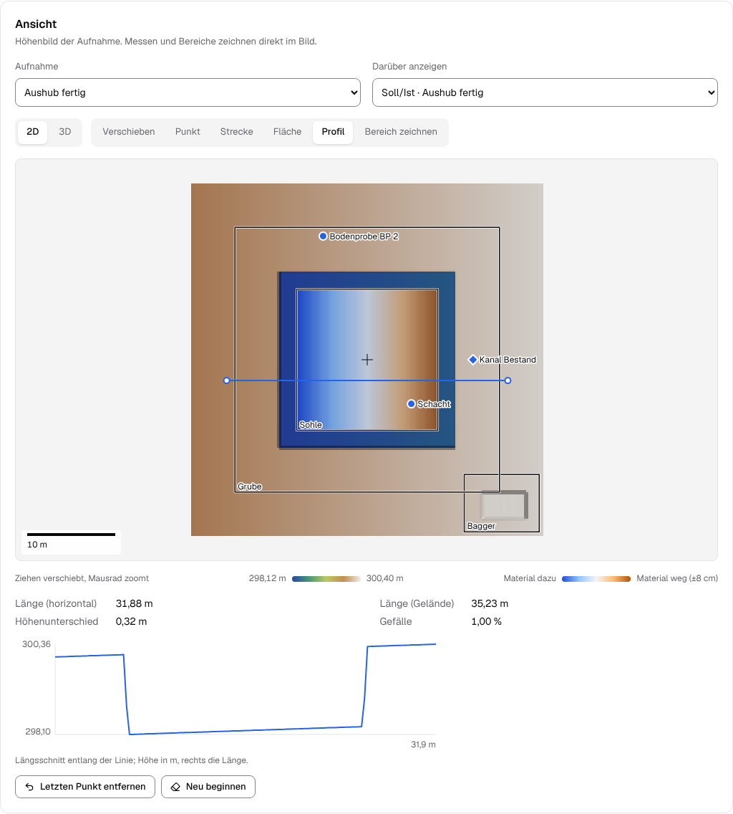
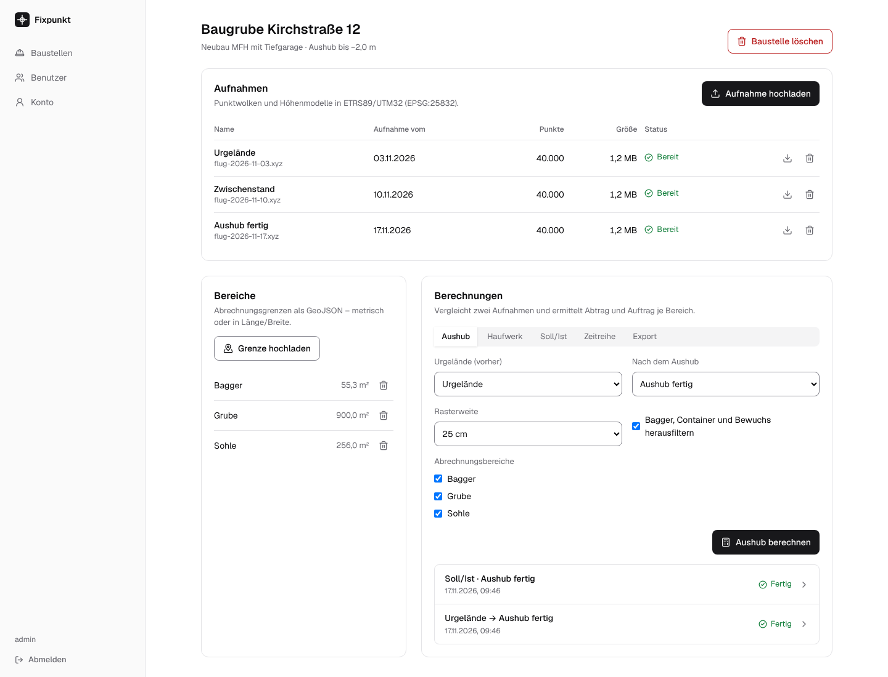
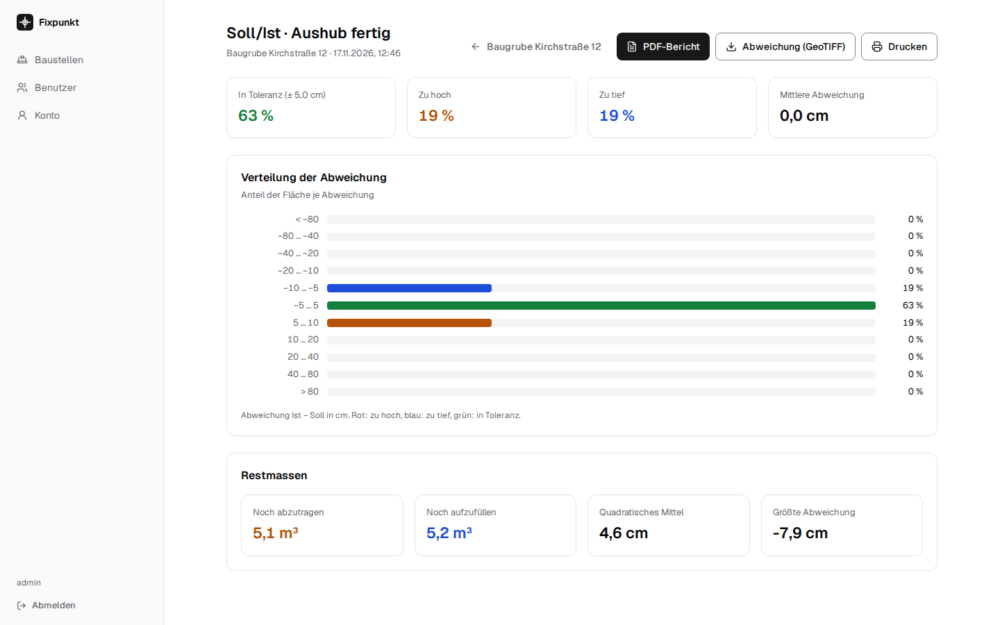
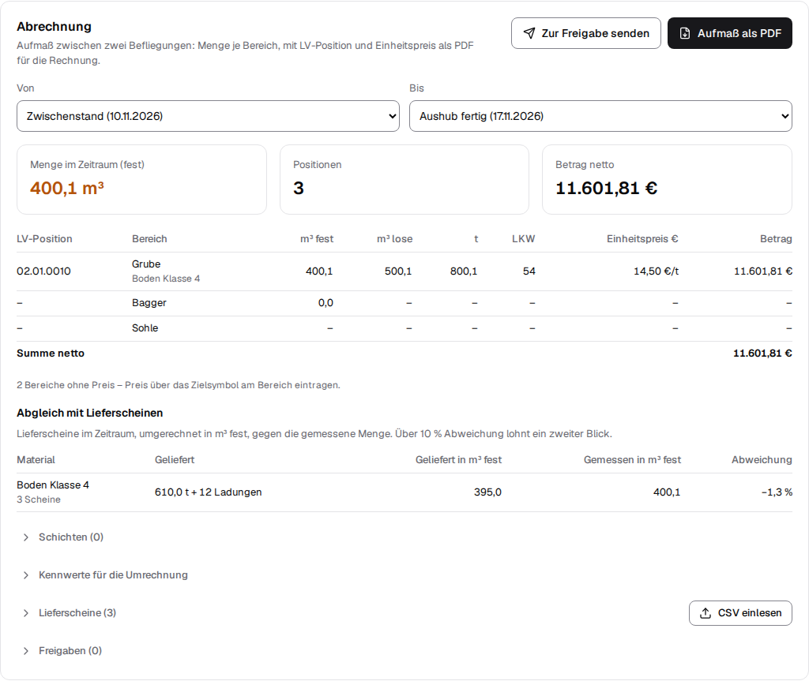
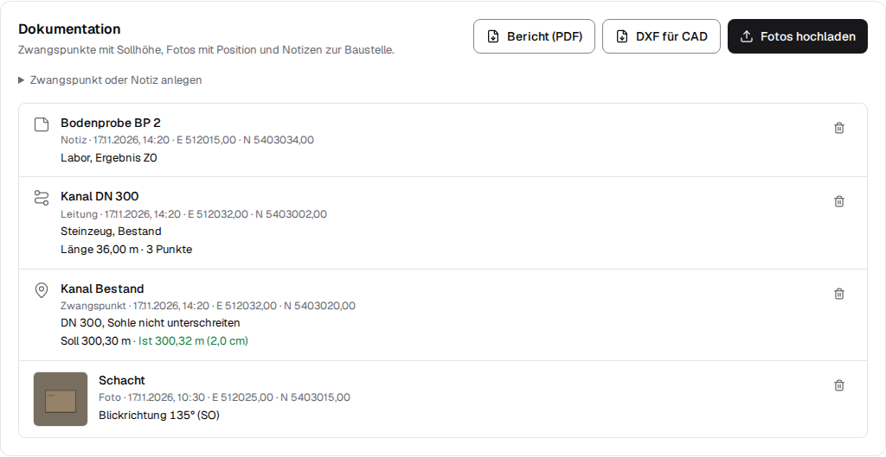
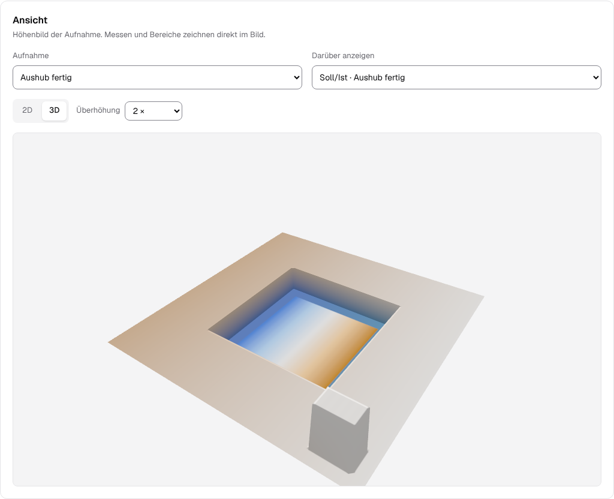
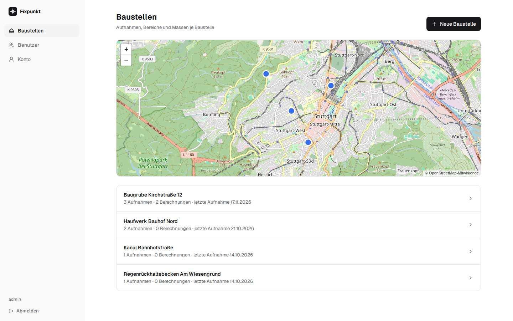

<div align="center">

<h1>Fixpunkt: drone-based earthwork surveys, billing and site records</h1>

<picture>
  <source media="(prefers-color-scheme: dark)" srcset="docs/screenshot-bericht-dunkel.png">
  
</picture>

**Self-hosted for earthworks and civil engineering: from drone flight to billable quantity.**<br>
Volumes per billing area with excavators and vegetation filtered out, plan vs. actual of the formation, progress across all flights.
Measurement statements with prices, delivery tickets, GAEB X31 and client approval; photos, constraint points, utility lines and DXF plans in the right place.
One binary with a web UI, ETRS89/UTM32 and DHHN2016 – no cloud subscription, on your own server.

[](https://github.com/Speicherstadt/fixpunkt/actions/workflows/ci.yml)
[](https://github.com/Speicherstadt/fixpunkt/releases/latest)
[](https://speicherstadt.github.io/fixpunkt/)
[](https://speicherstadt.github.io/fixpunkt/daten.html)
[](https://hub.docker.com/r/tristanteu/fixpunkt)

[Why?](#why-fixpunkt) •
[Features](#features) •
[Quick start](#quick-start) •
[FAQ](#faq) •
[Documentation](https://speicherstadt.github.io/fixpunkt/) •
[Development](#development) •
[Deutsch](README.md)

<sub>The app is available in German and English; the documentation website is in German for now.</sub>

<picture>
  <source media="(prefers-color-scheme: dark)" srcset="docs/screenshot-ansicht-dunkel.png">
  
</picture>

</div>

> [!NOTE]
> Fixpunkt does not replace an official survey. Until the accuracy is proven on your sites, check results against
> delivery notes or a survey before billing.

## Why Fixpunkt?

How much soil came out of a construction pit is usually estimated from delivery notes or measured by a surveying
office – days later, and again for every date. An RTK drone captures the pit in a quarter of an hour; what's
missing is the step from point cloud to a billable quantity.

- **Quantities on the day of the flight:** upload a capture, compare two states, cut and fill per billing area.
- **The excavator doesn't count:** a ground filter removes machines, containers and vegetation and fills in the
  terrain below.
- **Bill what was measured:** statement per period with item number and unit price, checked against delivery
  tickets, as PDF or GAEB X31 – the client approves it via a link.
- **Documented where it happened:** photos, constraint points, utility lines and notes sit at their place in the
  terrain, as a PDF for the file.
- **Your data stays with you:** one binary with SQLite, no cloud subscription; only the background map comes from
  OpenStreetMap and can be turned off.
- **Official coordinates:** ETRS89/UTM32 (EPSG:25832), heights in DHHN2016 via the GCG2016 quasigeoid.

## Features

Briefly per area; the details are on the linked page of the [documentation](https://speicherstadt.github.io/fixpunkt/) (German).

| Area | What Fixpunkt does |
|---|---|
| 📐 [Volumes](https://speicherstadt.github.io/fixpunkt/aushub.html) · [Calculations](https://speicherstadt.github.io/fixpunkt/berechnungen.html) | Cut and fill from two captures per area, stockpiles against a base surface, time series across the project, plan vs. actual against a formation level, an inclined plane or a design surface, ground filter for excavators, containers and vegetation; quantity report as PDF with map, CSV or GeoTIFF; site overview arranged by each user, also as a site report (PDF) |
| 💶 [Billing](https://speicherstadt.github.io/fixpunkt/abrechnung.html) · [Billing and law](https://speicherstadt.github.io/fixpunkt/recht.html) | Statement per period with bill-of-quantities item and unit price, in bank and loose m³, tonnes and truck loads, split by soil layers; delivery tickets by hand or as CSV, checked against the statement; PDF and GAEB DA XML X31; client approval via link, without an account |
| 🛰️ [Data](https://speicherstadt.github.io/fixpunkt/daten.html) · [Flight planning](https://speicherstadt.github.io/fixpunkt/flugplanung.html) · [Drone photos](https://speicherstadt.github.io/fixpunkt/drohnenfotos.html) | Point clouds (LAS, LAZ, E57, XYZ, CSV, PTS), elevation models (GeoTIFF from OpenDroneMap, ASC); mapping flight as KMZ for DJI Pilot 2; process drone photos directly via NodeODM; billing boundaries as GeoJSON from QGIS, latitude/longitude converted to UTM32; flight date per capture |
| 🗺️ [View and measure](https://speicherstadt.github.io/fixpunkt/ansicht.html) | Elevation image or orthophoto with difference or deviation on top, terrain or point cloud in 3D with vertical exaggeration; measure point, distance, slope, area and profile; draw billing areas in the browser; map of all sites; works with mouse and keyboard |
| 📷 [Site records](https://speicherstadt.github.io/fixpunkt/dokumentation.html) · [Plans](https://speicherstadt.github.io/fixpunkt/plaene.html) | Photos with GPS position and viewing direction in the terrain, constraint points with design and actual height, notes, utility lines with heights from the capture; DXF plans as background with plan vs. actual; as PDF for the file and as DXF for CAD |
| 👷 [As a team](https://speicherstadt.github.io/fixpunkt/benutzer.html) | Roles admin, edit, read-only; sign in with password or passkey, API tokens for programs; live status for checks and calculations; installable on tablet and phone, light and dark, in German and English |
| 🧮 [Exports and command line](https://speicherstadt.github.io/fixpunkt/kommandozeile.html) | GeoTIFF, DXF with contour lines, LandXML, CSV, OBJ and orthophoto from the web UI; control points (Helmert) with residuals, transform coordinates and heights; ground filter, outliers and profiles on the command line |
| 🔒 [Self-hosted](https://speicherstadt.github.io/fixpunkt/installation.html) | One binary with SQLite, no cloud subscription; Docker image or systemd without a container; login with argon2id, CSRF protection |

## Screenshots

<table>
  <tr>
    <td width="50%"><picture><source media="(prefers-color-scheme: dark)" srcset="docs/screenshot-baustelle-dunkel.png"></picture><br><sub><b>Volumes</b>: calculations from original terrain to finished excavation</sub></td>
    <td width="50%"><picture><source media="(prefers-color-scheme: dark)" srcset="docs/screenshot-soll-ist-dunkel.png"></picture><br><sub><b>Plan vs. actual</b>: floor within tolerance, distribution of the deviation, remaining volumes</sub></td>
  </tr>
  <tr>
    <td width="50%"><br><sub><b>Billing</b>: statement with prices, checked against delivery tickets</sub></td>
    <td width="50%"><br><sub><b>Site records</b>: notes, constraint points and photos at their place</sub></td>
  </tr>
  <tr>
    <td width="50%"><br><sub><b>3D</b>: terrain exaggerated, floor deviation in colour</sub></td>
    <td width="50%"><picture><source media="(prefers-color-scheme: dark)" srcset="docs/screenshot-baustellen-dunkel.png"></picture><br><sub><b>Sites</b>: map and list with captures and calculations</sub></td>
  </tr>
</table>

## Quick start

Fixpunkt runs as one container (`tristanteu/fixpunkt`, amd64 and arm64) or as a binary with systemd, on any Linux
server, NAS or mini PC. The drone photos are processed by [OpenDroneMap](https://opendronemap.org/), directly from
Fixpunkt via NodeODM if you like.

### 1. Let an agent set it up

Give Claude Code or another coding agent this repository and SSH access to your server and say:
"Set up Fixpunkt on my server, following the [installation guide](https://speicherstadt.github.io/fixpunkt/installation.html)." (German)

### 2. Manually

**Docker or Podman:**

```bash
docker run -d --name fixpunkt -p 8080:8080 -v fixpunkt:/data --restart unless-stopped tristanteu/fixpunkt
```

**Without a container** – one binary as a systemd service:

```bash
curl -fsSL https://raw.githubusercontent.com/Speicherstadt/fixpunkt/main/scripts/install.sh | sudo sh
```

Then open `http://<server>:8080` and create the first account. Compose, Podman Quadlet, settings and reverse proxy:
[Installation](https://speicherstadt.github.io/fixpunkt/installation.html) ·
[Configuration](https://speicherstadt.github.io/fixpunkt/konfiguration.html) (German).

## FAQ

<details>
<summary><b>How accurate is the volume calculation from drone data?</b></summary>

The calculation is exact down to the grid size (checked against the cone and frustum formulas, 0.004 % with
4 million points). The accuracy comes from the data: an RTK drone measures heights to 2–5 cm. What holds is the
balance; more under [Method and accuracy](https://speicherstadt.github.io/fixpunkt/methode.html) (German).
</details>

<details>
<summary><b>Do I need a specific drone?</b></summary>

No. Fixpunkt works with point clouds and elevation models from any source. For results without ground control
points the drone needs RTK (e.g. DJI Matrice 4E with SAPOS correction data). Laser scans (LAS/LAZ, E57) work too.
</details>

<details>
<summary><b>Does Fixpunkt process the drone photos itself?</b></summary>

Via [NodeODM](https://github.com/OpenDroneMap/NodeODM): upload the photos in Fixpunkt, NodeODM computes the point
cloud, and it appears as a capture – in the UTM zone of the site
([Processing drone photos](https://speicherstadt.github.io/fixpunkt/drohnenfotos.html), German). Without NodeODM,
upload the point cloud from WebODM.
</details>

<details>
<summary><b>What can Fixpunkt do, and what's next?</b></summary>

Everything at a glance in the [feature overview](https://speicherstadt.github.io/fixpunkt/funktionen.html); the
iPhone app with RTK rover for utility trenches and field testing on real sites are on the
[roadmap](https://speicherstadt.github.io/fixpunkt/roadmap.html), the hardware under
[devices](https://speicherstadt.github.io/fixpunkt/geraete.html) (all German).
</details>

<details>
<summary><b>Can I bill with Fixpunkt?</b></summary>

Yes. In Germany there is no certification for the software or method; the civil code (BGB) and VOB/B require a
verifiable, traceable quantity calculation. What it takes – agreement with the client, drone regulations, legal
metrology, data protection – is described under
[Billing and law](https://speicherstadt.github.io/fixpunkt/recht.html) (German).
</details>

<details>
<summary><b>Which coordinate systems are supported?</b></summary>

ETRS89/UTM zone 32 (EPSG:25832) by default, other UTM zones on the command line. Heights DHHN2016 via GCG2016.
</details>

## Documentation

Everything in detail, with search: **https://speicherstadt.github.io/fixpunkt/** (German). Every feature above links its page; in addition:

- **Getting started:** [Feature overview](https://speicherstadt.github.io/fixpunkt/funktionen.html),
  [Devices](https://speicherstadt.github.io/fixpunkt/geraete.html),
  [First steps](https://speicherstadt.github.io/fixpunkt/erste-schritte.html) and
  [Backup and updates](https://speicherstadt.github.io/fixpunkt/backup.html)
- **Background:** [Method and accuracy](https://speicherstadt.github.io/fixpunkt/methode.html),
  [Architecture](https://speicherstadt.github.io/fixpunkt/architektur.html) and
  [Roadmap](https://speicherstadt.github.io/fixpunkt/roadmap.html)

## Development

[](https://speicherstadt.github.io/fixpunkt/architektur.html)

Rust server (axum, SQLite) with an embedded React UI (Bun, Vite, TanStack, Paraglide) and the processing core as a
library. Tests on every layer, from results against known formulas to Playwright against the finished binary.

```bash
bun install
bun run dev    # server on :8080, UI with hot reload on http://localhost:5173 (admin / adminadmin)
```

Structure and tests: [Architecture](https://speicherstadt.github.io/fixpunkt/architektur.html) ·
[Development and tests](https://speicherstadt.github.io/fixpunkt/entwicklung.html) (German).

## More from us

More open-source apps for your own server, covering accounting, email, office documents and more: **[speicherstadt.app](https://speicherstadt.app)**

## Contributing

Bug reports and ideas are welcome as an [issue](https://github.com/Speicherstadt/fixpunkt/issues/new).

## Star history

<a href="https://www.star-history.com/#Speicherstadt/fixpunkt&Date">
  <picture>
    <source media="(prefers-color-scheme: dark)" srcset="https://api.star-history.com/svg?repos=Speicherstadt/fixpunkt&type=Date&theme=dark">
    
  </picture>
</a>

---

<div align="center">

⭐ **Like Fixpunkt?** A [star on GitHub](https://github.com/Speicherstadt/fixpunkt) helps others find it.

[Report a bug](https://github.com/Speicherstadt/fixpunkt/issues/new) &nbsp;·&nbsp; [Suggest a feature](https://github.com/Speicherstadt/fixpunkt/issues/new)

<sub><a href="README.md">Deutsch</a></sub>

</div>
