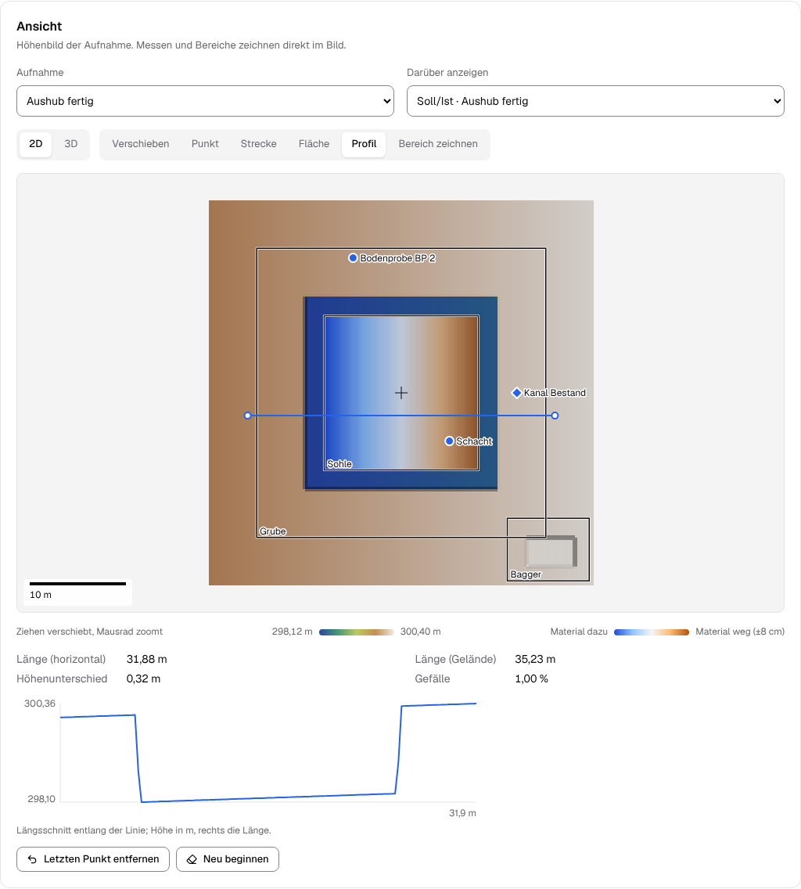
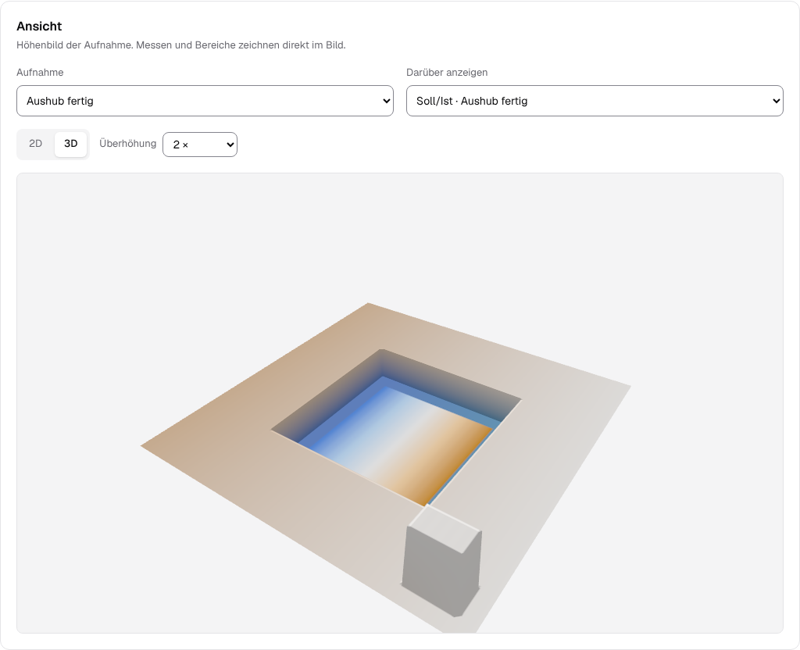

<div align="center">

<h1>Fixpunkt: Aufmaß und Baustellendokumentation aus Drohnenflügen</h1>

<picture>
  <source media="(prefers-color-scheme: dark)" srcset="docs/screenshot-bericht-dunkel.png">
  
</picture>

**Selbst gehostet für Erd- und Tiefbau: vom Drohnenflug zur abrechenbaren Menge.**<br>
Massen je Abrechnungsbereich mit Bagger und Bewuchs herausgerechnet, Soll/Ist der Sohle, Fortschritt über alle Befliegungen.
Aufmaß mit Preisen, Lieferscheinen, GAEB X31 und Freigabe durch den Auftraggeber; Fotos, Zwangspunkte, Leitungen und DXF-Pläne am richtigen Ort.
Eine Programmdatei mit Web-UI, ETRS89/UTM32 und DHHN2016 – ohne Cloud-Abo, auf deinem Server.

[](https://github.com/Speicherstadt/fixpunkt/actions/workflows/ci.yml)
[](https://github.com/Speicherstadt/fixpunkt/releases/latest)
[](https://speicherstadt.github.io/fixpunkt/)
[](https://speicherstadt.github.io/fixpunkt/daten.html)
[](https://hub.docker.com/r/tristanteu/fixpunkt)

[Warum?](#warum-fixpunkt) •
[Funktionen](#funktionen) •
[Schnellstart](#schnellstart) •
[FAQ](#faq) •
[Dokumentation](https://speicherstadt.github.io/fixpunkt/) •
[Entwicklung](#entwicklung)

<picture>
  <source media="(prefers-color-scheme: dark)" srcset="docs/screenshot-ansicht-dunkel.png">
  
</picture>

</div>

> [!NOTE]
> Fixpunkt ersetzt kein amtliches Aufmaß. Bis die Genauigkeit auf euren Baustellen belegt ist, Ergebnisse vor der
> Abrechnung mit Lieferscheinen oder einem Aufmaß plausibilisieren.

## Warum Fixpunkt?

Wie viel Boden aus der Baugrube gekommen ist, wird heute mit Lieferscheinen geschätzt oder vom Vermessungsbüro
aufgemessen – Tage später und für jeden Termin neu. Eine RTK-Drohne erfasst die Baugrube in einer Viertelstunde;
was fehlt, ist der Schritt von der Punktwolke zur abrechenbaren Menge.

- **Massen am Tag des Flugs:** Aufnahme hochladen, zwei Stände vergleichen, Abtrag und Auftrag je Abrechnungsbereich.
- **Der Bagger zählt nicht mit:** ein Bodenfilter entfernt Maschinen, Container und Bewuchs und ergänzt das Gelände darunter.
- **Abrechnen, was gemessen ist:** Aufmaß je Zeitraum mit LV-Position und Preis, gegen Lieferscheine gerechnet, als PDF oder GAEB X31 – der Auftraggeber gibt es per Link frei.
- **Dokumentiert, wo es passiert ist:** Fotos, Zwangspunkte, Leitungen und Notizen liegen an ihrer Stelle im Gelände, als PDF für die Akte.
- **Deine Daten bleiben bei dir:** eine Programmdatei mit SQLite, kein Cloud-Abo; nur die Hintergrundkarte kommt von OpenStreetMap und lässt sich abschalten.
- **Amtliche Koordinaten:** ETRS89/UTM32 (EPSG:25832), Höhen in DHHN2016 über das Quasigeoid GCG2016.

## Funktionen

Kurz je Bereich; die Details stehen auf der verlinkten Seite der [Dokumentation](https://speicherstadt.github.io/fixpunkt/).

| Bereich | Was Fixpunkt kann |
|---|---|
| 📐 [Massenermittlung](https://speicherstadt.github.io/fixpunkt/aushub.html) · [Berechnungen](https://speicherstadt.github.io/fixpunkt/berechnungen.html) | Aushub und Auftrag aus zwei Aufnahmen je Bereich, Haufwerke gegen Basisfläche, Zeitreihe über die Bauphase, Soll/Ist gegen Sohlhöhe, geneigte Ebene oder Soll-DGM, Bodenfilter für Bagger, Container und Bewuchs; Mengenbericht als PDF mit Karte, CSV oder GeoTIFF; Überblick je Baustelle, von jedem selbst zusammengestellt, auch als Baustellenbericht (PDF) |
| 💶 [Abrechnung](https://speicherstadt.github.io/fixpunkt/abrechnung.html) · [Abrechnung und Recht](https://speicherstadt.github.io/fixpunkt/recht.html) | Aufmaß je Zeitraum mit LV-Position und Einheitspreis, in m³ fest und lose, Tonnen und LKW-Fahrten, nach Schichten (Homogenbereichen); Lieferscheine von Hand oder als CSV, gegen das Aufmaß gerechnet; PDF und GAEB DA XML X31; Freigabe durch den Auftraggeber per Link, ohne eigenes Konto |
| 🛰️ [Daten](https://speicherstadt.github.io/fixpunkt/daten.html) · [Flugplanung](https://speicherstadt.github.io/fixpunkt/flugplanung.html) · [Drohnenfotos](https://speicherstadt.github.io/fixpunkt/drohnenfotos.html) | Punktwolken (LAS, LAZ, E57, XYZ, CSV, PTS), Höhenmodelle (GeoTIFF aus OpenDroneMap, ASC); Kartierflug als KMZ für DJI Pilot 2; Drohnenfotos direkt über NodeODM auswerten; Abrechnungsgrenzen als GeoJSON aus QGIS, Länge/Breite nach UTM32 umgerechnet; Flugdatum je Aufnahme |
| 🗺️ [Ansicht und Messen](https://speicherstadt.github.io/fixpunkt/ansicht.html) | Höhenbild oder Orthofoto mit Differenz oder Abweichung darüber, Gelände oder Punktwolke in 3D mit Überhöhung; Punkt, Strecke, Gefälle, Fläche und Profil messen; Abrechnungsbereiche im Browser zeichnen; Karte aller Baustellen; mit Maus und Tastatur bedienbar |
| 📷 [Dokumentation](https://speicherstadt.github.io/fixpunkt/dokumentation.html) · [Pläne](https://speicherstadt.github.io/fixpunkt/plaene.html) | Fotos mit GPS-Position und Blickrichtung im Gelände, Zwangspunkte mit Soll- und Isthöhe, Notizen, Leitungen mit Höhen aus der Aufnahme; DXF-Pläne als Hintergrund mit Plan/Ist; als PDF für die Akte und als DXF fürs CAD |
| 👷 [Im Team](https://speicherstadt.github.io/fixpunkt/benutzer.html) | Rollen Admin, Bearbeiten, Nur lesen; Anmelden mit Passwort oder Passkey, API-Tokens für Programme; Live-Status für Prüfung und Berechnung; auf Tablet und Handy installierbar, hell und dunkel, auf Deutsch und Englisch |
| 🧮 [Exporte und Kommandozeile](https://speicherstadt.github.io/fixpunkt/kommandozeile.html) | GeoTIFF, DXF mit Höhenlinien, LandXML, CSV, OBJ und Orthofoto aus der Web-UI; Passpunkte (Helmert) mit Restklaffen, Koordinaten und Höhen umrechnen; Bodenfilter, Ausreißer und Profile auf der Kommandozeile |
| 🔒 [Selbst gehostet](https://speicherstadt.github.io/fixpunkt/installation.html) | Eine Programmdatei mit SQLite, kein Cloud-Abo; Docker-Image oder systemd ohne Container; Login mit argon2id, Schutz gegen CSRF |

## Screenshots

<table>
  <tr>
    <td width="50%"><picture><source media="(prefers-color-scheme: dark)" srcset="docs/screenshot-baustelle-dunkel.png"></picture><br><sub><b>Massen</b>: Berechnungen vom Urgelände bis zum fertigen Aushub</sub></td>
    <td width="50%"><picture><source media="(prefers-color-scheme: dark)" srcset="docs/screenshot-soll-ist-dunkel.png"></picture><br><sub><b>Soll/Ist</b>: Sohle in Toleranz, Verteilung der Abweichung, Restmassen</sub></td>
  </tr>
  <tr>
    <td width="50%"><br><sub><b>Abrechnung</b>: Aufmaß mit Preisen, gegen Lieferscheine gerechnet</sub></td>
    <td width="50%"><br><sub><b>Dokumentation</b>: Notizen, Zwangspunkte und Fotos an ihrer Stelle</sub></td>
  </tr>
  <tr>
    <td width="50%"><br><sub><b>3D</b>: Gelände überhöht, Abweichung der Sohle farbig</sub></td>
    <td width="50%"><picture><source media="(prefers-color-scheme: dark)" srcset="docs/screenshot-baustellen-dunkel.png"></picture><br><sub><b>Baustellen</b>: Karte und Liste mit Aufnahmen und Berechnungen</sub></td>
  </tr>
</table>

## Schnellstart

Fixpunkt läuft als ein Container (`tristanteu/fixpunkt`, amd64 und arm64) oder als Programmdatei mit systemd, auf
jedem Linux-Server, NAS oder Mini-PC. Die Fotos der Drohne wertet [OpenDroneMap](https://opendronemap.org/) aus,
auf Wunsch direkt aus Fixpunkt über NodeODM.

### 1. Von einem Agenten aufsetzen lassen

Gib Claude Code oder einem anderen Coding-Agenten dieses Repository und SSH-Zugang zu deinem Server und sag:
„Setz Fixpunkt auf meinem Server auf, nach der [Installationsanleitung](https://speicherstadt.github.io/fixpunkt/installation.html).“

### 2. Manuell

**Docker oder Podman:**

```bash
docker run -d --name fixpunkt -p 8080:8080 -v fixpunkt:/data --restart unless-stopped tristanteu/fixpunkt
```

**Ohne Container** – eine Programmdatei als systemd-Dienst:

```bash
curl -fsSL https://raw.githubusercontent.com/Speicherstadt/fixpunkt/main/scripts/install.sh | sudo sh
```

Dann `http://<server>:8080` öffnen und den ersten Zugang anlegen. Compose, Podman Quadlet, Einstellungen und
Reverse-Proxy: [Installation](https://speicherstadt.github.io/fixpunkt/installation.html) ·
[Konfiguration](https://speicherstadt.github.io/fixpunkt/konfiguration.html).

Keinen eigenen Server oder keine eigene IT? Fixpunkt gibt es gehostet oder über einen IT-Dienstleister aus dem
[Partnerprogramm](https://speicherstadt.org/partner/).

## FAQ

<details>
<summary><b>Wie genau ist die Massenberechnung aus Drohnendaten?</b></summary>

Die Rechnung ist bis auf die Rasterweite exakt (geprüft gegen Kegel- und Pyramidenstumpfformel, 0,004 % bei
4 Mio. Punkten). Die Genauigkeit kommt aus den Daten: eine RTK-Drohne misst Höhen auf 2–5 cm. Belastbar ist die
Bilanz; mehr unter [Methode und Genauigkeit](https://speicherstadt.github.io/fixpunkt/methode.html).
</details>

<details>
<summary><b>Brauche ich eine bestimmte Drohne?</b></summary>

Nein. Fixpunkt rechnet mit Punktwolken und Höhenmodellen, egal woher. Für Ergebnisse ohne Passpunkte braucht die
Drohne RTK (z. B. DJI Matrice 4E mit SAPOS). Auch Laserscans (LAS/LAZ, E57) passen.
</details>

<details>
<summary><b>Rechnet Fixpunkt die Drohnenfotos selbst?</b></summary>

Über [NodeODM](https://github.com/OpenDroneMap/NodeODM): Fotos in Fixpunkt hochladen, NodeODM rechnet die
Punktwolke, sie erscheint als Aufnahme – in der Zone der Baustelle
([Drohnenfotos auswerten](https://speicherstadt.github.io/fixpunkt/drohnenfotos.html)). Ohne NodeODM lädt man die
Punktwolke aus WebODM hoch.
</details>

<details>
<summary><b>Was kann Fixpunkt, und was kommt noch?</b></summary>

Alles auf einen Blick im [Funktionsumfang](https://speicherstadt.github.io/fixpunkt/funktionen.html); die
iPhone-App mit RTK-Rover für Leitungsgräben und die Erprobung auf echten Baustellen stehen in der
[Roadmap](https://speicherstadt.github.io/fixpunkt/roadmap.html), die nötigen Geräte unter
[Geräte](https://speicherstadt.github.io/fixpunkt/geraete.html).
</details>

<details>
<summary><b>Darf ich mit Fixpunkt abrechnen?</b></summary>

Ja. Eine Zertifizierung für Software oder Verfahren gibt es nicht; BGB und VOB/B verlangen eine prüfbare,
nachvollziehbare Mengenberechnung. Was dazugehört – Vereinbarung mit dem Auftraggeber, Drohnenrecht, Eichrecht,
Datenschutz –, steht unter [Abrechnung und Recht](https://speicherstadt.github.io/fixpunkt/recht.html).
</details>

<details>
<summary><b>Welche Koordinatensysteme werden unterstützt?</b></summary>

ETRS89/UTM Zone 32 (EPSG:25832) als Standard, andere UTM-Zonen auf der Kommandozeile. Höhen DHHN2016 über GCG2016.
</details>

## Dokumentation

Alles im Detail, mit Suche: **https://speicherstadt.github.io/fixpunkt/**. Jede Funktion oben verlinkt ihre Seite; dazu kommen:

- **Einstieg:** [Funktionsumfang](https://speicherstadt.github.io/fixpunkt/funktionen.html),
  [Geräte](https://speicherstadt.github.io/fixpunkt/geraete.html),
  [Erste Schritte](https://speicherstadt.github.io/fixpunkt/erste-schritte.html) und
  [Backup und Updates](https://speicherstadt.github.io/fixpunkt/backup.html)
- **Hintergrund:** [Methode und Genauigkeit](https://speicherstadt.github.io/fixpunkt/methode.html),
  [Architektur](https://speicherstadt.github.io/fixpunkt/architektur.html) und
  [Roadmap](https://speicherstadt.github.io/fixpunkt/roadmap.html)

## Entwicklung

[](https://www.rust-lang.org)
[](https://www.typescriptlang.org)
[](https://react.dev)
[](https://tanstack.com)
[](https://tailwindcss.com)
[](https://vite.dev)
[](https://github.com/launchbadge/sqlx)

Rust-Server (axum, SQLite) mit eingebetteter React-UI (Bun, Vite, TanStack, Paraglide) und Rechenkern als
Bibliothek. Tests auf jeder Schicht, von Rechenergebnissen gegen bekannte Formeln bis Playwright gegen die
fertige Programmdatei.

```bash
bun install
bun run dev    # Server auf :8080, UI mit Hot Reload auf http://localhost:5173 (admin / adminadmin)
```

Aufbau und Tests: [Architektur](https://speicherstadt.github.io/fixpunkt/architektur.html) ·
[Entwicklung und Tests](https://speicherstadt.github.io/fixpunkt/entwicklung.html).

## Mehr von uns

Weitere Open-Source-Apps für deinen eigenen Server, etwa für Buchhaltung, Mail, Office-Dokumente und mehr: **[speicherstadt.org](https://speicherstadt.org)**

## Mitwirken

Fehler und Ideen gern als [Issue](https://github.com/Speicherstadt/fixpunkt/issues/new).

## Sterne im Verlauf

<a href="https://www.star-history.com/#Speicherstadt/fixpunkt&Date">
  <picture>
    <source media="(prefers-color-scheme: dark)" srcset="https://api.star-history.com/svg?repos=Speicherstadt/fixpunkt&type=Date&theme=dark">
    
  </picture>
</a>

---

<div align="center">

⭐ **Gefällt dir Fixpunkt?** Ein [Stern auf GitHub](https://github.com/Speicherstadt/fixpunkt) hilft anderen, es zu finden.

[Fehler melden](https://github.com/Speicherstadt/fixpunkt/issues/new) &nbsp;·&nbsp; [Funktion vorschlagen](https://github.com/Speicherstadt/fixpunkt/issues/new)

<sub>Für IT-Dienstleister und Hoster: <a href="https://speicherstadt.org/partner/">Partnerprogramm</a>.</sub>

</div>
