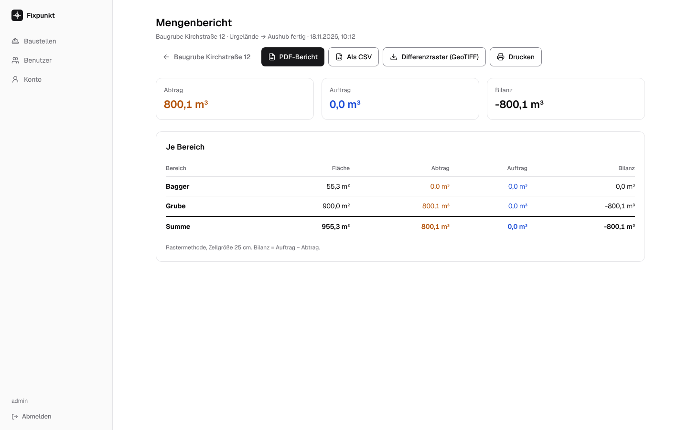
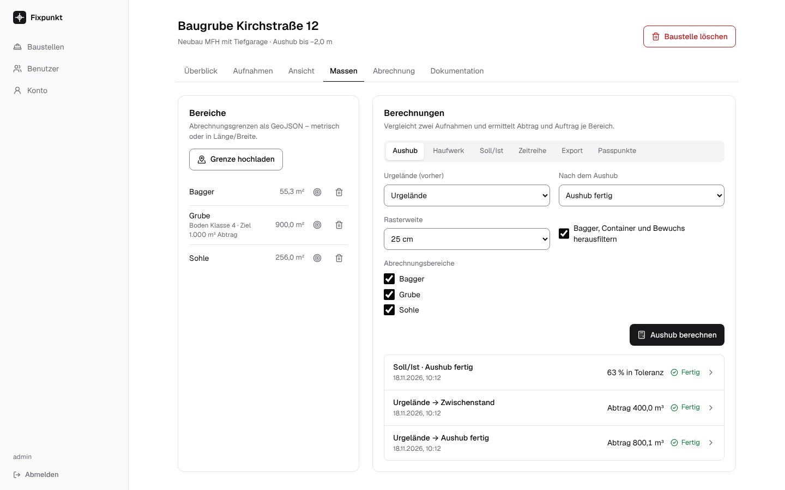

<div align="center">


<h1>Fixpunkt: Aufmaß und Baustellendokumentation aus Drohnenflügen</h1>

**Deutsch** · [English](README.en.md)

**Selbst gehostet für Erd- und Tiefbau: vom Drohnenflug zur abrechenbaren Menge.**<br>
Massen je Abrechnungsbereich mit Bagger und Bewuchs herausgerechnet, Soll/Ist der Sohle, Fortschritt über alle Befliegungen.<br>
Aufmaß mit Preisen, Lieferscheinen, GAEB X31 und Freigabe durch den Auftraggeber; Fotos, Zwangspunkte, Leitungen und DXF-Pläne am richtigen Ort.<br>
Eine Programmdatei mit Web-UI, ETRS89/UTM32 und DHHN2016 – ohne Cloud-Abo, auf deinem Server.

[](https://github.com/Speicherstadt/fixpunkt/actions/workflows/ci.yml)
[](https://github.com/Speicherstadt/fixpunkt/releases/latest)
[](https://speicherstadt.github.io/fixpunkt/)
[](https://hub.docker.com/r/tristanteu/fixpunkt)
[](https://hub.docker.com/r/tristanteu/fixpunkt/tags)
[](https://hub.docker.com/r/tristanteu/fixpunkt/tags)
[](https://speicherstadt.github.io/fixpunkt/architektur.html)
[](https://speicherstadt.github.io/fixpunkt/daten.html)

```bash
docker run -d -p 8080:8080 -v fixpunkt:/data tristanteu/fixpunkt
```

[Warum?](#-warum-fixpunkt) •
[Funktionen](#-funktionen) •
[Installation](#-installation) •
[FAQ](#-faq) •
[Dokumentation](https://speicherstadt.github.io/fixpunkt/) •
[Entwicklung](#️-entwicklung)

<picture>
  <source media="(prefers-color-scheme: dark)" srcset="docs/screenshot-bericht-dunkel.png">
  
</picture>

</div>

## 💡 Warum Fixpunkt?

Wie viel Boden aus der Baugrube gekommen ist, wird heute mit Lieferscheinen geschätzt oder vom Vermessungsbüro
aufgemessen – Tage später und für jeden Termin neu. Eine RTK-Drohne erfasst die Baugrube in einer Viertelstunde;
was fehlt, ist der Schritt von der Punktwolke zur abrechenbaren Menge.

- **Massen am Tag des Flugs:** Aufnahme hochladen, zwei Stände vergleichen, Abtrag und Auftrag je Abrechnungsbereich.
- **Der Bagger zählt nicht mit:** ein Bodenfilter entfernt Maschinen, Container und Bewuchs und ergänzt das Gelände darunter.
- **Abrechnen, was gemessen ist:** Aufmaß je Zeitraum mit LV-Position und Preis, gegen Lieferscheine gerechnet, als PDF oder GAEB X31 – der Auftraggeber gibt es per Link frei.
- **Dokumentiert, wo es passiert ist:** Fotos, Zwangspunkte, Leitungen und Notizen liegen an ihrer Stelle im Gelände, als PDF für die Akte.
- **Deine Daten bleiben bei dir:** eine Programmdatei mit SQLite, kein Cloud-Abo; nur die Hintergrundkarte kommt von OpenStreetMap und lässt sich abschalten.
- **Amtliche Koordinaten:** ETRS89/UTM32 (EPSG:25832), Höhen in DHHN2016 über das Quasigeoid GCG2016.

Läuft auf jedem Linux-Server, NAS oder Mini-PC – mit Docker, Podman oder als systemd-Dienst. Die Fotos der Drohne
wertet [OpenDroneMap](https://opendronemap.org/) aus, auf Wunsch direkt aus Fixpunkt über NodeODM.

## ✨ Funktionen

<table>
<tr>
<td width="50%" valign="top">

### 📐 Massenermittlung
- Aushub und Auftrag aus zwei Aufnahmen, je Bereich
- Haufwerke gegen Basisfläche, Zeitreihe über die Bauphase
- Soll/Ist gegen Sohlhöhe, geneigte Ebene oder Soll-DGM
- Bodenfilter für Bagger, Container und Bewuchs
- Mengenbericht als PDF mit Karte, als CSV oder GeoTIFF
- Überblick je Baustelle, von jedem selbst zusammengestellt: Aushub je Befliegung, Massenziele, Lagerbestand und Verlauf je Material, Soll/Ist, Zwangspunkte – auch als eigener Baustellenbericht (PDF)

</td>
<td width="50%" valign="top">

### 💶 Abrechnung
- Aufmaß je Zeitraum mit LV-Position und Einheitspreis
- In m³ fest und lose, Tonnen und LKW-Fahrten, nach Schichten (Homogenbereichen)
- Lieferscheine von Hand oder als CSV, gegen das Aufmaß gerechnet
- Aufmaß als PDF und GAEB DA XML X31 für die Abrechnungssoftware
- Freigabe durch den Auftraggeber per Link, ohne eigenes Konto
- [Abrechnung](https://speicherstadt.github.io/fixpunkt/abrechnung.html) · [Abrechnung und Recht](https://speicherstadt.github.io/fixpunkt/recht.html)

</td>
</tr>
<tr>
<td width="50%" valign="top">

### 🛰️ Daten
- Punktwolken: LAS, LAZ, E57 (Laserscanner), XYZ, CSV, PTS
- Höhenmodelle: GeoTIFF (OpenDroneMap), ASC
- Flugplanung: Kartierflug als KMZ für DJI Pilot 2
- Drohnenfotos direkt auswerten über NodeODM
- Abrechnungsgrenzen als GeoJSON aus QGIS, mehrere Bereiche je Datei
- Grenzen in Länge/Breite werden nach UTM32 umgerechnet
- Flugdatum je Aufnahme, auch für nachträglich hochgeladene Flüge

</td>
<td width="50%" valign="top">

### 🗺️ Ansicht und Messen
- Höhenbild oder Orthofoto jeder Aufnahme, Differenz oder Abweichung darübergelegt
- Gelände oder Punktwolke in 3D, in Farbe oder nach Intensität, mit Überhöhung
- Messen: Punkt, Strecke, Gefälle, Fläche, Profil
- Abrechnungsbereiche direkt im Browser zeichnen
- Karte aller Baustellen
- Bedienbar mit Maus und Tastatur

</td>
</tr>
<tr>
<td width="50%" valign="top">

### 📷 Dokumentation
- Fotos mit GPS-Position und Blickrichtung an ihrer Stelle im Gelände
- Zwangspunkte mit Soll- und Isthöhe, Notizen
- Leitungen nachzeichnen, mit Höhen aus der Aufnahme
- DXF-Pläne als Hintergrund, Höhen aus dem Plan gegen das Gelände (Plan/Ist)
- Als PDF für die Akte und als DXF fürs CAD

</td>
<td width="50%" valign="top">

### 👷 Im Team
- Benutzer mit Rollen: Admin, Bearbeiten, Nur lesen
- Anmelden mit Passwort oder Passkey, API-Tokens für Programme
- Live-Status: Prüfung und Berechnung aktualisieren sich von selbst
- Auf Tablet und Handy installierbar, hell und dunkel
- Oberfläche auf Deutsch und Englisch

</td>
</tr>
<tr>
<td width="50%" valign="top">

### 🧮 Exporte und Kommandozeile
- GeoTIFF, DXF mit Höhenlinien, LandXML, CSV, OBJ, Orthofoto als GeoTIFF – aus der Web-UI
- Passpunkte (Helmert) mit Restklaffen in der Web-UI, Koordinaten und Höhen umrechnen
- Bodenfilter, Ausreißer, Profile auf der Kommandozeile
- [Alle Befehle](https://speicherstadt.github.io/fixpunkt/kommandozeile.html)

</td>
<td width="50%" valign="top">

### 🔒 Selbst gehostet
- Eine Programmdatei mit SQLite, kein Cloud-Abo
- Docker-Image für amd64 und arm64, oder systemd ohne Container
- Login mit argon2id, Schutz gegen CSRF
- [Installation](https://speicherstadt.github.io/fixpunkt/installation.html)

</td>
</tr>
</table>

<p align="center">
  <picture>
    <source media="(prefers-color-scheme: dark)" srcset="docs/screenshot-ansicht-dunkel.png">
    
  </picture>
  <picture>
    <source media="(prefers-color-scheme: dark)" srcset="docs/screenshot-baustelle-dunkel.png">
    
  </picture>
</p>

## 🚀 Installation

**Docker oder Podman** (amd64, arm64):

```bash
docker run -d --name fixpunkt -p 8080:8080 -v fixpunkt:/data --restart unless-stopped tristanteu/fixpunkt
```

**Ohne Container** – eine Programmdatei als systemd-Dienst:

```bash
curl -fsSL https://raw.githubusercontent.com/Speicherstadt/fixpunkt/main/scripts/install.sh | sudo sh
```

Dann `http://<server>:8080` öffnen und den ersten Zugang anlegen. Compose, Podman Quadlet, Einstellungen und
Reverse-Proxy: [Installation](https://speicherstadt.github.io/fixpunkt/installation.html) ·
[Konfiguration](https://speicherstadt.github.io/fixpunkt/konfiguration.html).

## ❓ FAQ

**Wie genau ist die Massenberechnung aus Drohnendaten?**<br>
Die Rechnung ist bis auf die Rasterweite exakt (geprüft gegen Kegel- und Pyramidenstumpfformel, 0,004 % bei
4 Mio. Punkten). Die Genauigkeit kommt aus den Daten: eine RTK-Drohne misst Höhen auf 2–5 cm. Belastbar ist die
Bilanz; mehr unter [Methode und Genauigkeit](https://speicherstadt.github.io/fixpunkt/methode.html).

**Brauche ich eine bestimmte Drohne?**<br>
Nein. Fixpunkt rechnet mit Punktwolken und Höhenmodellen, egal woher. Für Ergebnisse ohne Passpunkte braucht die
Drohne RTK (z. B. DJI Matrice 4E mit SAPOS). Auch Laserscans (LAS/LAZ, E57) passen.

**Rechnet Fixpunkt die Drohnenfotos selbst?**<br>
Über [NodeODM](https://github.com/OpenDroneMap/NodeODM): Fotos in Fixpunkt hochladen, NodeODM rechnet die
Punktwolke, sie erscheint als Aufnahme – in der Zone der Baustelle
([Drohnenfotos auswerten](https://speicherstadt.github.io/fixpunkt/drohnenfotos.html)). Ohne NodeODM lädt man die
Punktwolke aus WebODM hoch.

**Was kann Fixpunkt, und was kommt noch?**<br>
Alles auf einen Blick im [Funktionsumfang](https://speicherstadt.github.io/fixpunkt/funktionen.html); die
iPhone-App mit RTK-Rover für Leitungsgräben und die Erprobung auf echten Baustellen stehen in der
[Roadmap](https://speicherstadt.github.io/fixpunkt/roadmap.html), die nötigen Geräte unter
[Geräte](https://speicherstadt.github.io/fixpunkt/geraete.html).

**Darf ich mit Fixpunkt abrechnen?**<br>
Ja. Eine Zertifizierung für Software oder Verfahren gibt es nicht; BGB und VOB/B verlangen eine prüfbare,
nachvollziehbare Mengenberechnung. Was dazugehört – Vereinbarung mit dem Auftraggeber, Drohnenrecht, Eichrecht,
Datenschutz –, steht unter [Abrechnung und Recht](https://speicherstadt.github.io/fixpunkt/recht.html).

**Welche Koordinatensysteme werden unterstützt?**<br>
ETRS89/UTM Zone 32 (EPSG:25832) als Standard, andere UTM-Zonen auf der Kommandozeile. Höhen DHHN2016 über GCG2016.

## 🛠️ Entwicklung

Rust-Server (axum, SQLite) mit eingebetteter React-UI (Bun, Vite, TanStack, Paraglide) und Rechenkern als
Bibliothek. Tests auf jeder Schicht, von Rechenergebnissen gegen bekannte Formeln bis Playwright gegen die
fertige Programmdatei.

```bash
bun install
bun run dev    # Server auf :8080, UI mit Hot Reload auf http://localhost:5173 (admin / adminadmin)
```

[Architektur](https://speicherstadt.github.io/fixpunkt/architektur.html) ·
[Entwicklung und Tests](https://speicherstadt.github.io/fixpunkt/entwicklung.html) ·
[Roadmap](https://speicherstadt.github.io/fixpunkt/roadmap.html)

> [!NOTE]
> Fixpunkt ersetzt kein amtliches Aufmaß. Bis die Genauigkeit auf euren Baustellen belegt ist, Ergebnisse vor der
> Abrechnung mit Lieferscheinen oder einem Aufmaß plausibilisieren.
