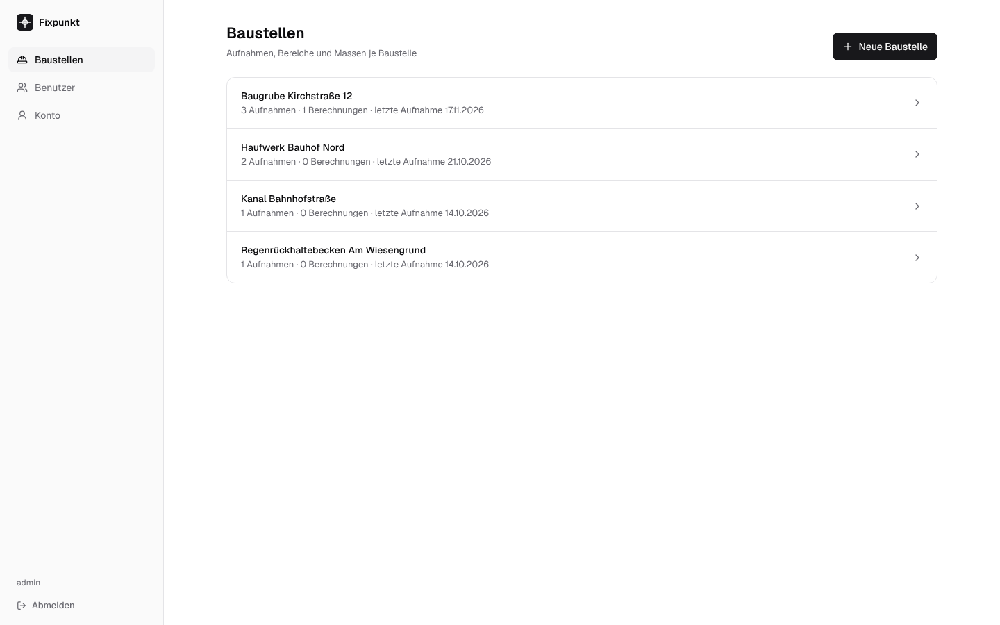

<div align="center">


<h1>Fixpunkt: Aushub und Haufwerke aus Drohnenflügen berechnen</h1>

**Selbst gehostete Massenermittlung für Baustellen: Punktwolke oder Höhenmodell hochladen, Abrechnungsgrenze setzen, Mengenbericht in m³.**<br>
Vergleicht Urgelände und Aushub je Abrechnungsbereich, rechnet Bagger und Bewuchs heraus und gibt den Bericht als CSV, GeoTIFF oder Ausdruck weiter.<br>
Eine Programmdatei mit Web-UI, ETRS89/UTM32 und DHHN2016 – ohne Cloud-Abo, auf deinem Server.

[](https://github.com/firsttris/fixpunkt/actions/workflows/ci.yml)
[](https://github.com/firsttris/fixpunkt/releases/latest)
[](https://firsttris.github.io/fixpunkt/)
[](https://hub.docker.com/r/tristanteu/fixpunkt)
[](https://hub.docker.com/r/tristanteu/fixpunkt/tags)
[](https://firsttris.github.io/fixpunkt/architektur.html)
[](https://firsttris.github.io/fixpunkt/daten.html)

```bash
docker run -d -p 8080:8080 -v fixpunkt:/data tristanteu/fixpunkt
```

[Warum?](#-warum-fixpunkt) •
[Funktionen](#-funktionen) •
[Installation](#-installation) •
[FAQ](#-faq) •
[Dokumentation](https://firsttris.github.io/fixpunkt/) •
[Entwicklung](#️-entwicklung)

<sub>English: self-hosted earthwork volume calculation from drone surveys – upload point clouds (LAS/LAZ) or elevation models (GeoTIFF, e.g. from OpenDroneMap), set billing boundaries, get cut and fill per area. One binary with web UI. The app is in German and English, the documentation in German.</sub>

<picture>
  <source media="(prefers-color-scheme: dark)" srcset="docs/screenshot-bericht-dunkel.png">
  
</picture>

</div>

## 💡 Warum Fixpunkt?

Wie viel Boden aus der Baugrube gekommen ist, wird heute mit Lieferscheinen geschätzt oder vom Vermessungsbüro
aufgemessen – Tage später und für jeden Termin neu. Eine RTK-Drohne erfasst die Baugrube in einer Viertelstunde;
was fehlt, ist der Schritt von der Punktwolke zur abrechenbaren Menge.

- **Massen am Tag des Flugs:** Aufnahme hochladen, zwei Stände vergleichen, Abtrag und Auftrag je Abrechnungsbereich.
- **Der Bagger zählt nicht mit:** ein Bodenfilter entfernt Maschinen, Container und Bewuchs und ergänzt das Gelände darunter.
- **Deine Daten bleiben bei dir:** eine Programmdatei mit SQLite, kein Cloud-Abo, kein fremder Dienst.
- **Amtliche Koordinaten:** ETRS89/UTM32 (EPSG:25832), Höhen in DHHN2016 über das Quasigeoid GCG2016.

Läuft auf jedem Linux-Server, NAS oder Mini-PC – mit Docker, Podman oder als systemd-Dienst. Die Fotos der Drohne
wertet [OpenDroneMap](https://opendronemap.org/) aus.

## ✨ Funktionen

<table>
<tr>
<td width="50%" valign="top">

### 📐 Massenermittlung
- Aushub und Auftrag aus zwei Aufnahmen, je Bereich
- Bodenfilter für Bagger, Container und Bewuchs
- Warnung, wenn ein Bereich nicht ganz erfasst ist
- Bericht als CSV, Differenzraster (GeoTIFF), Ausdruck

</td>
<td width="50%" valign="top">

### 🛰️ Daten
- Punktwolken: LAS, LAZ, XYZ, CSV
- Höhenmodelle: GeoTIFF (OpenDroneMap), ASC
- Abrechnungsgrenzen als GeoJSON aus QGIS, mehrere Bereiche je Datei
- Grenzen in Länge/Breite werden nach UTM32 umgerechnet

</td>
</tr>
<tr>
<td width="50%" valign="top">

### 👷 Im Team
- Benutzer mit Rollen: Admin, Bearbeiten, Nur lesen
- Live-Status: Prüfung und Berechnung aktualisieren sich von selbst
- Auf Tablet und Handy installierbar, hell und dunkel
- Oberfläche auf Deutsch und Englisch

</td>
<td width="50%" valign="top">

### 🧮 Kommandozeile
- Haufwerke gegen Ausgleichsebene, Soll/Ist gegen Sohle oder Soll-DGM, Zeitreihen
- Passpunkt-Transformation (Helmert), Koordinaten und Höhen umrechnen
- Exporte: GeoTIFF, DXF mit Höhenlinien, LandXML, OBJ, PLY, CSV
- [Alle Befehle](https://firsttris.github.io/fixpunkt/kommandozeile.html)

</td>
</tr>
</table>

<p align="center">
  
  
</p>

## 🚀 Installation

**Docker oder Podman** (amd64, arm64):

```bash
docker run -d --name fixpunkt -p 8080:8080 -v fixpunkt:/data --restart unless-stopped tristanteu/fixpunkt
```

**Ohne Container** – eine Programmdatei als systemd-Dienst:

```bash
curl -fsSL https://raw.githubusercontent.com/firsttris/fixpunkt/main/scripts/install.sh | sudo sh
```

Dann `http://<server>:8080` öffnen und den ersten Zugang anlegen. Compose, Podman Quadlet, Einstellungen und
Reverse-Proxy: [Installation](https://firsttris.github.io/fixpunkt/installation.html) ·
[Konfiguration](https://firsttris.github.io/fixpunkt/konfiguration.html).

## ❓ FAQ

**Wie genau ist die Massenberechnung aus Drohnendaten?**<br>
Die Rechnung ist bis auf die Rasterweite exakt (geprüft gegen Kegel- und Pyramidenstumpfformel, 0,004 % bei
4 Mio. Punkten). Die Genauigkeit kommt aus den Daten: eine RTK-Drohne misst Höhen auf 2–5 cm. Belastbar ist die
Bilanz; mehr unter [Methode und Genauigkeit](https://firsttris.github.io/fixpunkt/methode.html).

**Brauche ich eine bestimmte Drohne?**<br>
Nein. Fixpunkt rechnet mit Punktwolken und Höhenmodellen, egal woher. Für Ergebnisse ohne Passpunkte braucht die
Drohne RTK (z. B. DJI Matrice 4E mit SAPOS). Auch Laserscanner (LAS/LAZ) und iPhone-LiDAR-Scans passen.

**Rechnet Fixpunkt die Drohnenfotos selbst?**<br>
Noch nicht. Die Photogrammetrie macht [OpenDroneMap](https://opendronemap.org/)/WebODM; deren Punktwolke oder
Geländemodell lädt man hoch. Die direkte Anbindung ist geplant.

**Ist Fixpunkt eine Alternative zu SDX-Cloud, Propeller oder DroneDeploy?**<br>
Für die Massenermittlung von Baugruben und Haufwerken: ja, selbst gehostet und ohne Abo. Viewer, Messungen im 3D
und die iPhone-App mit RTK-Rover folgen ([Projektplan](https://firsttris.github.io/fixpunkt/PLAN.html)).

**Welche Koordinatensysteme werden unterstützt?**<br>
ETRS89/UTM Zone 32 (EPSG:25832) als Standard, andere UTM-Zonen auf der Kommandozeile. Höhen DHHN2016 über GCG2016.

## 🛠️ Entwicklung

Rust-Server (axum, SQLite) mit eingebetteter React-UI (Bun, Vite, TanStack, Paraglide) und Rechenkern als
Bibliothek. Tests auf jeder Schicht, von Rechenergebnissen gegen bekannte Formeln bis Playwright gegen die
fertige Programmdatei.

```bash
bun install
bun run dev    # Server auf :8080, UI mit Hot Reload auf http://localhost:5173 (admin / adminadmin)
```

[Architektur](https://firsttris.github.io/fixpunkt/architektur.html) ·
[Entwicklung und Tests](https://firsttris.github.io/fixpunkt/entwicklung.html) ·
[Projektplan](https://firsttris.github.io/fixpunkt/PLAN.html)

> [!NOTE]
> Fixpunkt ersetzt kein amtliches Aufmaß. Bis die Genauigkeit auf euren Baustellen belegt ist, Ergebnisse vor der
> Abrechnung mit Lieferscheinen oder einem Aufmaß plausibilisieren.
