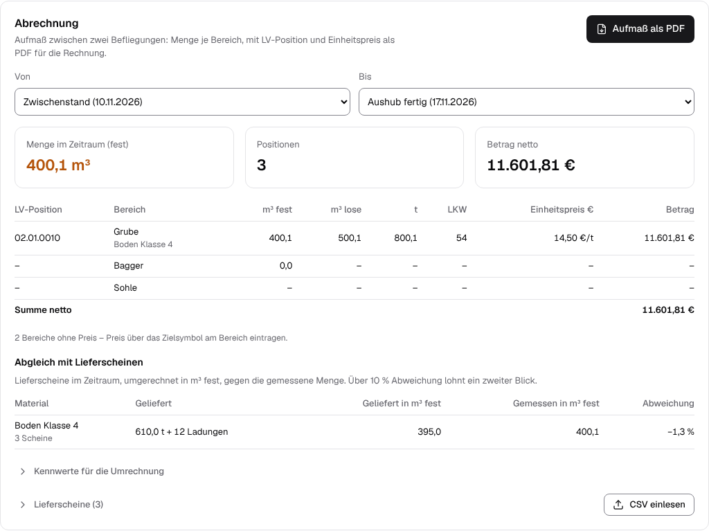

# Abrechnung

Aus den Mengen wird eine Rechnung: Fixpunkt stellt für einen **Zeitraum zwischen zwei Befliegungen** ein Aufmaß
zusammen – je Bereich mit Leistungsposition, Menge, Einheitspreis und Betrag – und prüft es gegen die
**Lieferscheine** desselben Zeitraums. Das Aufmaßblatt gibt es als PDF für die Abschlags- oder Schlussrechnung.
Was rechtlich dazugehört, steht unter [Abrechnung und Recht](recht.md).



## 1. Preis am Bereich

Das Zielscheiben-Symbol neben einem Bereich ([Material und Massenziel](aushub.md#material-und-massenziel)) hat
drei weitere Felder:

- **LV-Position:** die Ordnungszahl aus dem Leistungsverzeichnis, z. B. `02.01.0010`. Das Aufmaß ist danach
  sortiert.
- **Einheitspreis €:** netto.
- **Preis gilt:** je **m³** (fest, wie gemessen), je **m³ lose** oder je **t**.

Lager (Haufwerk-Bereiche) werden nicht abgerechnet. Bereiche zum Auftragen rechnen mit dem Auftrag, alle anderen
mit dem Abtrag.

## 2. Kennwerte für die Umrechnung

Fixpunkt misst den Boden **fest**, also im gewachsenen Zustand. Abgerechnet wird aber oft anders: Deponien in
Tonnen, Transporte nach Fahrten, geladen wird lose. Unter **Abrechnung → Kennwerte für die Umrechnung** stehen alle
Materialien der Baustelle:

| Kennwert | Bedeutung | Rechnung |
|---|---|---|
| **Dichte in t/m³ (fest)** | Gewicht eines Kubikmeters im gewachsenen Zustand | t = m³ fest × Dichte |
| **Auflockerung (lose/fest)** | wie viel mehr Raum gelöster Boden einnimmt | m³ lose = m³ fest × Auflockerung |
| **Nutzlast eines LKW in t** | für die ganze Baustelle | Fahrten = t ÷ Nutzlast, aufgerundet |

Richtwerte, je nach Boden verschieden – besser aus Wiegescheinen der ersten Fahrten bestimmen:

| Material | Dichte t/m³ | Auflockerung |
|---|---|---|
| Oberboden | 1,6 | 1,25 |
| Sand, Kies | 1,9 | 1,15 |
| Lehm, Ton | 2,0 | 1,25 |
| Fels | 2,6 | 1,5 |

Fehlt ein Kennwert, rechnet Fixpunkt nicht mit einem geschätzten Wert, sondern zeigt „–“. Ein Preis je t oder
m³ lose bleibt dann ohne Betrag, und ein Hinweis nennt die betroffenen Bereiche.

## 3. Aufmaß für einen Zeitraum

Unter **Abrechnung** wählt man **Von** und **Bis**; vorgeschlagen ist der letzte Zeitraum, von der vorletzten bis
zur letzten Befliegung. Die Menge eines Zeitraums ist

> Aushub gegen das Urgelände bis „Bis“ − Aushub gegen das Urgelände bis „Von“.

Damit addieren sich die Zeiträume genau zur Gesamtmenge, und jede Abschlagsrechnung setzt dort an, wo die letzte
aufgehört hat. Grundlage sind die [Aushub-Berechnungen](aushub.md#3-berechnen) gegen die älteste Aufnahme; fehlt
eine, sagt Fixpunkt, für welche Befliegung.

Die Tabelle zeigt je Position die Menge in m³ fest, m³ lose, Tonnen und LKW-Fahrten, den Einheitspreis und den
Betrag; darunter die Summe netto. **Aufmaß als PDF** lädt das Aufmaßblatt herunter: Kopf mit Baustelle,
Zeitraum und Urgelände, Positionen, Mengen je Bereich (bisher, gesamt, im Zeitraum), Abgleich mit Lieferscheinen
und die verwendeten Kennwerte. Beträge sind auf Cent gerundet.

## 4. Lieferscheine

Lieferscheine und Wiegescheine lassen sich einzeln erfassen oder als CSV einlesen, etwa aus der Waage oder einer
Tabelle der Disposition:

```text
Datum;Material;Menge;Einheit;Lieferschein
12.11.2026;Boden Klasse 4;26,4;t;WS-2211
14.11.2026;Boden Klasse 4;12;Fahrten;LS-0815
16.11.2026;Boden Klasse 4;18;m³;LS-0816
```

- **Datum** als `12.11.2026` oder `2026-11-12`
- **Menge** mit Komma oder Punkt
- **Einheit** `t`, `m³` (lose, wie geladen) oder `Fahrten`/`Ladungen`/`LKW`
- Trennzeichen `;`, sonst `,` oder Tab; eine Kopfzeile ist erlaubt
- Eine fehlerhafte Zeile verhindert den ganzen Import; die Meldung nennt die Zeile.

Ein Schein zählt zu einem Zeitraum, wenn sein Tag **nach** dem Tag von „Von“ und **bis einschließlich** dem Tag
von „Bis“ liegt.

### Abgleich

Je Material rechnet Fixpunkt die Scheine des Zeitraums in m³ fest um (Tonnen über die Dichte, m³ lose über die
Auflockerung, Fahrten über Nutzlast und Dichte) und stellt sie der gemessenen Menge gegenüber. Die Abweichung ist

> (geliefert − gemessen) ÷ gemessen.

Über 10 % ist sie hervorgehoben. Kleine Abweichungen sind normal: Kennwerte sind Mittelwerte, LKW fahren selten
genau voll. Große Abweichungen deuten auf falsche Kennwerte, vergessene Scheine, Material aus einem anderen
Bereich oder eine fehlende Befliegung hin. Auf den ersten Baustellen ist der Abgleich der beste Beleg, dass die
Drohnenmengen stimmen ([Abrechnung und Recht → Checkliste](recht.md#checkliste)).

## Über die API

| Was | Aufruf |
|---|---|
| Kennwerte lesen, ersetzen | `GET`/`PUT /api/sites/{id}/billing/settings` |
| Aufmaß als JSON | `GET /api/sites/{id}/billing?from={Aufnahme}&to={Aufnahme}` |
| Aufmaßblatt als PDF | `GET /api/sites/{id}/billing.pdf?from=…&to=…` |
| Lieferscheine | `GET`/`POST /api/sites/{id}/deliveries`, `DELETE /api/deliveries/{id}` |
| CSV einlesen | `PUT /api/sites/{id}/deliveries.csv` (Datei als Körper) |
| Preis am Bereich | `PATCH /api/regions/{id}` mit `lvPosition`, `unitPrice`, `priceUnit` (`m3`, `m3_loose`, `t`) |

Mit einem [API-Token](benutzer.md#api-tokens) lassen sich so Lieferscheine aus anderen Programmen übernehmen.
