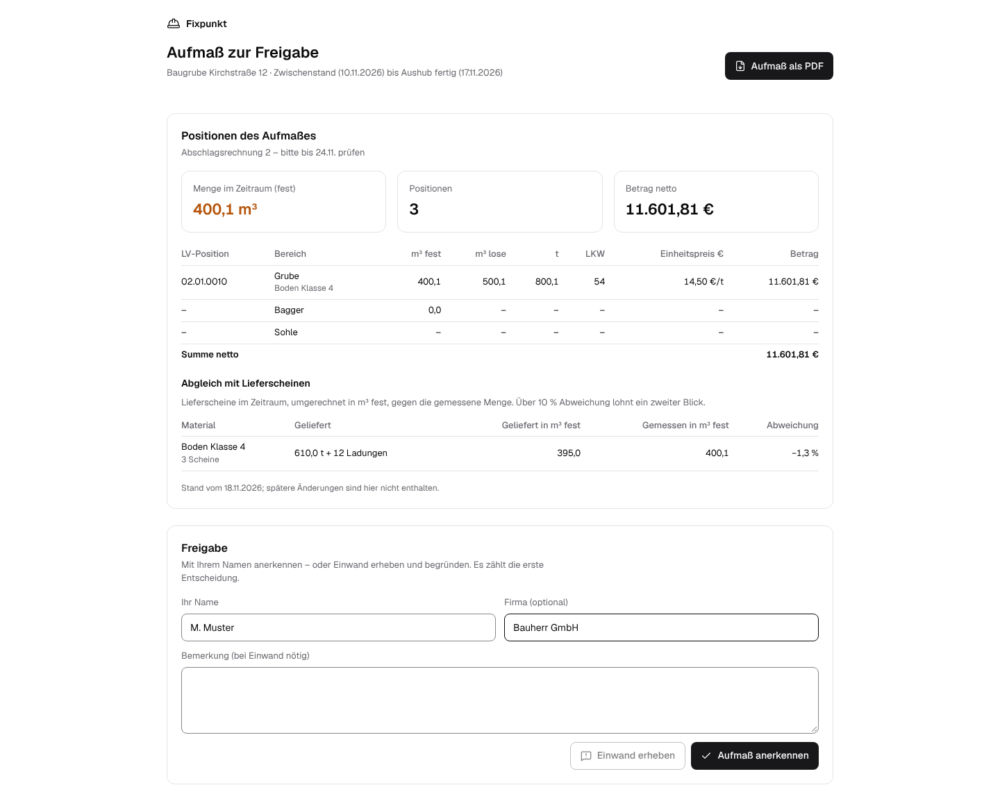

# Abrechnung

Aus den Mengen wird eine Rechnung: Fixpunkt stellt für einen **Zeitraum zwischen zwei Befliegungen** ein Aufmaß
zusammen – je Bereich mit Leistungsposition, Menge, Einheitspreis und Betrag – und prüft es gegen die
**Lieferscheine** desselben Zeitraums. Das Aufmaßblatt gibt es als PDF für die Abschlags- oder Schlussrechnung.
Was rechtlich dazugehört, steht unter [Abrechnung und Recht](recht.md).


## 1. Preis am Bereich

Das Zielscheiben-Symbol neben einem Bereich im Reiter **Massen** ([Material und Massenziel](aushub.md#material-und-massenziel)) hat
drei weitere Felder:

- **LV-Position:** die Ordnungszahl aus dem Leistungsverzeichnis, z. B. `02.01.0010`. Das Aufmaß ist danach
  sortiert.
- **Einheitspreis €:** netto.
- **Preis gilt:** je **m³** (fest, wie gemessen), je **m³ lose** oder je **t**.

Lager (Haufwerk-Bereiche) werden nicht abgerechnet. Bereiche zum Auftragen rechnen mit dem Auftrag, alle anderen
mit dem Abtrag.

## 2. Kennwerte für die Umrechnung

Fixpunkt misst den Boden **fest**, also im gewachsenen Zustand. Abgerechnet wird aber oft anders: Deponien in
Tonnen, Transporte nach Fahrten, geladen wird lose. Unter **Abrechnung → Kennwerte für die Umrechnung** stehen alle
Materialien der Baustelle:

| Kennwert | Bedeutung | Rechnung |
|---|---|---|
| **Dichte in t/m³ (fest)** | Gewicht eines Kubikmeters im gewachsenen Zustand | t = m³ fest × Dichte |
| **Auflockerung (lose/fest)** | wie viel mehr Raum gelöster Boden einnimmt | m³ lose = m³ fest × Auflockerung |
| **Nutzlast eines LKW in t** | für die ganze Baustelle | Fahrten = t ÷ Nutzlast, aufgerundet |

Richtwerte, je nach Boden verschieden – besser aus Wiegescheinen der ersten Fahrten bestimmen:

| Material | Dichte t/m³ | Auflockerung |
|---|---|---|
| Oberboden | 1,6 | 1,25 |
| Sand, Kies | 1,9 | 1,15 |
| Lehm, Ton | 2,0 | 1,25 |
| Fels | 2,6 | 1,5 |

Fehlt ein Kennwert, rechnet Fixpunkt nicht mit einem geschätzten Wert, sondern zeigt „–“. Ein Preis je t oder
m³ lose bleibt dann ohne Betrag, und ein Hinweis nennt die betroffenen Bereiche.

## 3. Aufmaß für einen Zeitraum

Im Reiter **Abrechnung** wählt man **Von** und **Bis**; vorgeschlagen ist der letzte Zeitraum, von der vorletzten bis
zur letzten Befliegung. Die Menge eines Zeitraums ist

> Aushub gegen das Urgelände bis „Bis“ − Aushub gegen das Urgelände bis „Von“.

Damit addieren sich die Zeiträume genau zur Gesamtmenge, und jede Abschlagsrechnung setzt dort an, wo die letzte
aufgehört hat. Grundlage sind die [Aushub-Berechnungen](aushub.md#3-berechnen) gegen die älteste Aufnahme; fehlt
eine, sagt Fixpunkt, für welche Befliegung.

Die Tabelle zeigt je Position die Menge in m³ fest, m³ lose, Tonnen und LKW-Fahrten, den Einheitspreis und den
Betrag; darunter die Summe netto. **Aufmaß als PDF** lädt das Aufmaßblatt herunter: Kopf mit Baustelle,
Zeitraum und Urgelände, Positionen, Mengen je Bereich (bisher, gesamt, im Zeitraum), Abgleich mit Lieferscheinen
und die verwendeten Kennwerte. Beträge sind auf Cent gerundet.

## 3a. Schichten (Homogenbereiche)

Oberboden, Lehm und Fels haben verschiedene Preise und gehen oft an verschiedene Stellen. Unter **Abrechnung →
Schichten** legt man sie von oben nach unten an:

| Schicht | Unterkante | LV-Position | Einheitspreis |
|---|---|---|---|
| Oberboden | 0,3 m | 02.01.0010 | 6,00 €/m³ |
| Lehm | 1,5 m | 02.01.0020 | 9,00 €/m³ |
| Fels | bis Sohle | 02.01.0030 | 40,00 €/m³ |

Die Unterkante zählt **unter dem Urgelände**, an jeder Stelle der Grube. Je Rasterzelle mit Abtragstiefe *d*
rechnet Fixpunkt in die Schicht von *oben* bis *unten* den Anteil

> min(*d*, unten) − oben (nicht negativ)

– bei 2 m Aushub also 0,3 m Oberboden, 1,2 m Lehm und 0,5 m Fels. Die Schichten zusammen ergeben genau den Abtrag
des Bereichs (geprüft gegen eine Grube mit bekannten Schichtdicken).

- Jede Schicht ist zugleich ein **Material** mit eigenen Kennwerten (Dichte, Auflockerung).
- Hat eine Schicht keinen eigenen Preis, gilt der des Bereichs.
- Das Aufmaß hat dann je Bereich eine Zeile je Schicht, etwa „Grube · Lehm“.
- Bereiche zum Auftragen und Lager werden nicht nach Schichten geteilt.
- Schichten gelten für **Aushub-Berechnungen, die danach starten**. Sind die Berechnungen älter, sagt Fixpunkt es
  und rechnet bis dahin je Bereich.

Die Schichtgrenzen sind waagerecht unter dem Urgelände angenommen, wie in einem Baugrundgutachten mit mittleren
Schichtdicken. Liegt eine Grenze schräg oder springt sie, teilt man die Grube in mehrere Bereiche.

## 4. Lieferscheine

Lieferscheine und Wiegescheine lassen sich einzeln erfassen oder als CSV einlesen, etwa aus der Waage oder einer
Tabelle der Disposition:

```text
Datum;Material;Menge;Einheit;Lieferschein
12.11.2026;Boden Klasse 4;26,4;t;WS-2211
14.11.2026;Boden Klasse 4;12;Fahrten;LS-0815
16.11.2026;Boden Klasse 4;18;m³;LS-0816
```

- **Datum** als `12.11.2026` oder `2026-11-12`
- **Menge** mit Komma oder Punkt
- **Einheit** `t`, `m³` (lose, wie geladen) oder `Fahrten`/`Ladungen`/`LKW`
- Trennzeichen `;`, sonst `,` oder Tab; eine Kopfzeile ist erlaubt
- Eine fehlerhafte Zeile verhindert den ganzen Import; die Meldung nennt die Zeile.

Ein Schein zählt zu einem Zeitraum, wenn sein Tag **nach** dem Tag von „Von“ und **bis einschließlich** dem Tag
von „Bis“ liegt.

### Abgleich

Je Material rechnet Fixpunkt die Scheine des Zeitraums in m³ fest um (Tonnen über die Dichte, m³ lose über die
Auflockerung, Fahrten über Nutzlast und Dichte) und stellt sie der gemessenen Menge gegenüber. Die Abweichung ist

> (geliefert − gemessen) ÷ gemessen.

Über 10 % ist sie hervorgehoben. Kleine Abweichungen sind normal: Kennwerte sind Mittelwerte, LKW fahren selten
genau voll. Große Abweichungen deuten auf falsche Kennwerte, vergessene Scheine, Material aus einem anderen
Bereich oder eine fehlende Befliegung hin. Auf den ersten Baustellen ist der Abgleich der beste Beleg, dass die
Drohnenmengen stimmen ([Abrechnung und Recht → Checkliste](recht.md#checkliste)).

## 4a. GAEB X31 für die Abrechnungssoftware

**GAEB X31** lädt das Aufmaß des Zeitraums als Mengenermittlung im Format **GAEB DA XML 3.3, Datenaustauschphase
X31** herunter. Die Datei lässt sich in AVA- und Abrechnungsprogramme einlesen, die GAEB beherrschen; das ist
bei öffentlichen Auftraggebern üblich.

- Je **LV-Position** steht die Menge in der Einheit des Preises (m³ fest, m³ lose oder t). Bereiche oder
  Schichten mit derselben LV-Position werden addiert; Bereiche ohne LV-Position fehlen in der Datei.
- Die Gliederung der Ordnungszahl ergibt sich aus den LV-Positionen, z. B. `02.01.0010` → zwei Stufen mit je
  2 Stellen und eine Position mit 4 Stellen. Alle LV-Positionen müssen derselben Gliederung folgen.
- Fixpunkt überträgt je Position die **Gesamtmenge**, keine Rechenansätze nach REB-VB 23.003 – die Menge stammt
  aus dem Vergleich zweier Geländemodelle. Die Fachdokumentation erlaubt das ausdrücklich (GAEB DA XML 3.3,
  Ausgabe 2023-01, Kapitel 7.3). Den Nachweis, wie die Menge entstand, liefert das Aufmaßblatt (PDF).
- Der Knopf erscheint, sobald es LV-Positionen gibt und sich jede Menge in ihre Preiseinheit umrechnen lässt.

Jede erzeugte Datei entspricht dem offiziellen Schema `GAEB_DA_XML_31_3.3_2023-01.xsd`; die CI prüft das
bei jeder Änderung gegen das Schema von [gaeb.de](https://www.gaeb.de).

## 5. Freigabe durch den Auftraggeber

Die VOB/B verlangt, die Feststellungen für die Abrechnung **möglichst gemeinsam** zu treffen
([Abrechnung und Recht](recht.md#vobb-und-vobc)). Dafür gibt es unter **Abrechnung → Zur Freigabe senden**
einen Link:

1. Zeitraum wählen, **Zur Freigabe senden**, optional eine Notiz („Abschlag Januar“), **Link erzeugen**.
2. Den Link kopieren oder per E-Mail schicken. Er erscheint **nur dieses eine Mal**; gespeichert ist nur ein
   Prüfwert, nicht der Link selbst.
3. Der Auftraggeber öffnet ihn **ohne Anmeldung** und sieht das Aufmaß so, wie es beim Erzeugen war – spätere
   Änderungen an Preisen oder Berechnungen ändern es nicht. Er kann das Aufmaßblatt als PDF laden.
4. Er **erkennt an** (mit Name und optional Firma) oder **erhebt Einwand** (mit Begründung). Es zählt die erste
   Entscheidung.
5. Unter **Abrechnung → Freigaben** steht der Stand live; das PDF dort enthält die Entscheidung mit Name und
   Zeit. **Zurückziehen** macht den Link unbrauchbar, eine schon getroffene Entscheidung bleibt erhalten.



Der Link ist so geheim wie ein Passwort: Wer ihn hat, sieht dieses eine Aufmaß – nichts sonst von der Baustelle.

## Über die API

| Was | Aufruf |
|---|---|
| Kennwerte lesen, ersetzen | `GET`/`PUT /api/sites/{id}/billing/settings` |
| Aufmaß als JSON | `GET /api/sites/{id}/billing?from={Aufnahme}&to={Aufnahme}` |
| Aufmaßblatt als PDF | `GET /api/sites/{id}/billing.pdf?from=…&to=…` |
| GAEB X31 | `GET /api/sites/{id}/billing.x31?from=…&to=…` |
| Lieferscheine | `GET`/`POST /api/sites/{id}/deliveries`, `DELETE /api/deliveries/{id}` |
| CSV einlesen | `PUT /api/sites/{id}/deliveries.csv` (Datei als Körper) |
| Schichten | `layers` in `PUT /api/sites/{id}/billing/settings` (`name`, `bottomM`, `lvPosition`, `unitPrice`, `priceUnit`) |
| Freigaben | `GET`/`POST /api/sites/{id}/billing/shares`, `DELETE /api/billing/shares/{id}`, `GET …/{id}/pdf` |
| Freigabe ohne Anmeldung | `GET /api/public/shares/{token}`, `POST …/decision`, `GET …/pdf` |
| Preis am Bereich | `PATCH /api/regions/{id}` mit `lvPosition`, `unitPrice`, `priceUnit` (`m3`, `m3_loose`, `t`) |

Mit einem [API-Token](benutzer.md#api-tokens) lassen sich so Lieferscheine aus anderen Programmen übernehmen.
