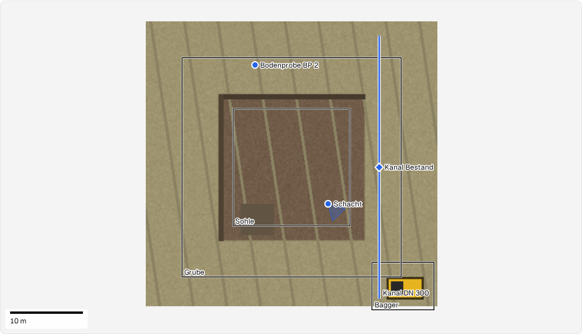
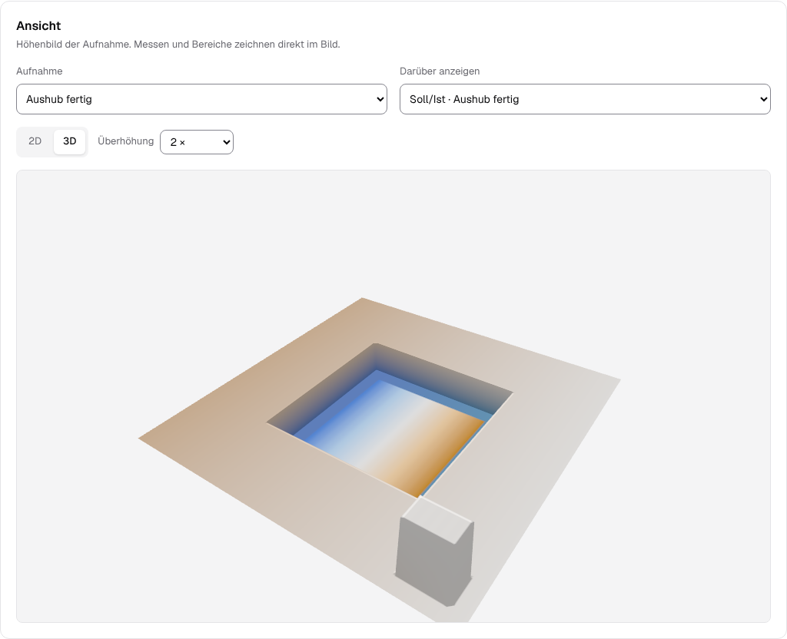
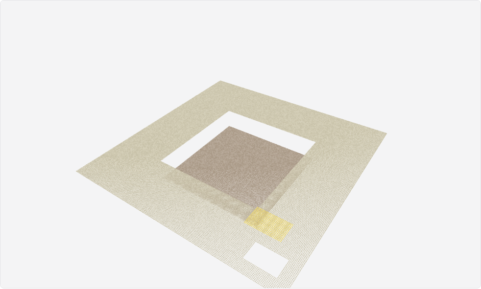

# Ansicht und Messen

Im Reiter **Ansicht** einer Baustelle zeigt Fixpunkt das Höhenbild einer Aufnahme: Farben von tief
(blau) nach hoch (braun, hell), mit Schummerung aus Nordwesten, damit Böschungen und Kanten plastisch wirken.

{ width="1440" height="900" }
{ width="1440" height="900" }

## Bedienen

| | Maus | Tastatur |
|---|---|---|
| verschieben | ziehen | Pfeiltasten |
| zoomen | Mausrad | `+` und `−` |
| alles zeigen | – | `0` |
| Punkt setzen | klicken | `Enter` setzt ihn am Fadenkreuz in der Mitte |

Unter dem Bild stehen Ost-, Nordwert und Höhe unter dem Mauszeiger, die Farbskala und der Maßstab.

## Orthofoto

Hat die Aufnahme ein **Orthofoto** – das entzerrte Luftbild aus derselben Befliegung –, zeigt die Ansicht es als
Hintergrund; unter **Hintergrund** lässt sich auf das Höhenbild umschalten. Differenz, Bereiche, Pläne und
Markierungen liegen darüber wie gewohnt.

{ width="982" height="563" loading="lazy" }

Aus [Drohnenfotos](drohnenfotos.md) übernimmt Fixpunkt das Orthofoto von NodeODM selbst. Sonst im Reiter
**Aufnahmen** in der Liste über das Bildsymbol ein GeoTIFF anhängen (RGB oder RGBA, z. B. `odm_orthophoto.tif` aus WebODM). Fixpunkt
verkleinert es für die Ansicht auf höchstens 4096 Pixel je Seite – bei einer 100-m-Baustelle rund 2,5 cm je Pixel –
und legt es auch dann richtig, wenn es in einer anderen UTM-Zone gerechnet wurde.

## Darüber anzeigen

**Darüber anzeigen** legt das Ergebnis einer Berechnung über das Höhenbild: die Differenz eines Aushubs oder die
Abweichung eines Soll/Ist-Vergleichs. Die Farben bedeuten überall dasselbe wie im Mengenbericht:
**orange = Material weg** (abgetragen bzw. noch zu hoch), **blau = Material dazu** (aufgeschüttet bzw. zu tief).

## Messen

| Werkzeug | Ergebnis |
|---|---|
| **Punkt** | Ostwert, Nordwert, Höhe |
| **Strecke** | Länge horizontal und über das Gelände, Höhenunterschied, mittleres Gefälle in % – auch als Polylinie |
| **Fläche** | Fläche horizontal und Oberfläche, Umfang, tiefste und höchste Höhe |
| **Profil** | wie Strecke, dazu der Längsschnitt als Diagramm |

Punkte nacheinander setzen; **Letzten Punkt entfernen** und **Neu beginnen** korrigieren. Die Werte stehen als
Liste unter dem Bild und werden von Screenreadern vorgelesen.

> [!NOTE]
> Gemessen wird auf dem Höhenbild der Ansicht. Bei großen Flächen ist es vergröbert (höchstens eine Million
> Zellen, z. B. 1 m bei 1 km²); für Massen gilt immer die Rasterweite der Berechnung.

## Bereiche zeichnen

Mit **Bereich zeichnen** die Ecken einer Abrechnungsgrenze nacheinander anklicken (mindestens drei, die Fläche
schließt sich selbst), einen Namen eingeben und **Bereich speichern**. Der Bereich steht danach im Reiter **Massen** unter **Bereiche**
und in allen Berechnungen zur Auswahl – ganz ohne QGIS. Für genaue Grenzen aus Plänen bleibt der Import als
[GeoJSON](daten.md#abrechnungsgrenzen-aus-qgis).

## Leitungen zeichnen

Mit **Leitung zeichnen** die Punkte entlang einer Leitung nacheinander anklicken (mindestens zwei). Länge und
Gefälle erscheinen wie bei **Strecke**; mit Name und Notiz gespeichert, steht die Leitung in der
[Dokumentation](dokumentation.md#leitungen) und als Linie in der Ansicht. Jeder Punkt bekommt die Höhe des
Geländes der gezeigten Aufnahme.

## 3D

**Darstellung → 3D** zeigt dasselbe Höhenraster als Gelände, mit denselben Farben: Höhenstufen oder – mit
**Darüber anzeigen** – die Differenz bzw. Soll/Ist-Abweichung (orange: Material weg, blau: dazu). So sieht man auf
einen Blick, wo an der Sohle noch zu viel steht oder ob Böschungen sauber laufen. **Überhöhung** streckt die Höhen
(1×, 2×, 5×), damit flache Mulden und Zentimeter-Abweichungen sichtbar werden.

{ width="1024" height="913" loading="lazy" }

| Bedienung | Maus | Tastatur |
|---|---|---|
| Drehen | ziehen | – |
| Verschieben | rechte Maustaste ziehen | Pfeiltasten (Ansicht vorher anklicken oder mit Tab wählen) |
| Zoomen | Rad | – |

### Punktwolke

Bei Punktwolken zeigt **Darstellung in 3D → Punktwolke** die gemessenen Punkte selbst statt des daraus gerechneten
Geländes – mit den Farben aus der Datei (Drohnen-Punktwolken aus ODM, farbige LAS/LAZ, E57 mit RGB), sonst nach
Höhe eingefärbt. Hat die Datei eine **Intensität** (Laserscanner: LAS, E57, PTS), schaltet **Färbung** zwischen
Farbe, Intensität (grau, die hellsten und dunkelsten 2 % abgeschnitten) und Höhe um – bei Scans ohne Kamera
zeigt die Intensität Markierungen, Kanten und Material oft besser als die Höhe. So sieht man, was der Bodenfilter herausrechnet: Bagger, Container, Bewuchs stehen als Punkte
über dem Gelände. Große Wolken zeigt die Ansicht gleichmäßig ausgedünnt mit höchstens einer Million Punkten.

{ width="982" height="591" loading="lazy" }

Messen und Zeichnen bleiben in 2D, wo Strecken und Flächen sich genau setzen lassen. Große Raster werden für 3D
ausgedünnt (höchstens 400 Stützpunkte je Seite); die 3D-Bibliothek (three.js) lädt erst beim Umschalten.
