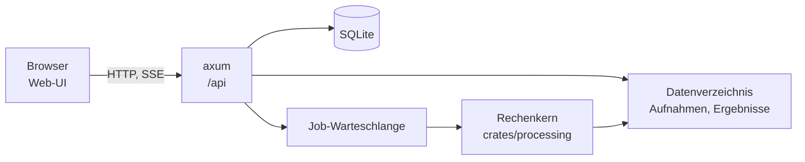

# Architektur

**Eine Programmdatei:** der Rust-Server liefert die gebaute Web-UI selbst aus (`rust-embed`), speichert in SQLite
und einem Ordner und rechnet im selben Prozess. Aufbau wie
[haul](https://github.com/firsttris/haul); die Technik folgt
[tech-stack.md](https://github.com/firsttris/workflows/blob/main/tech-stack.md), Abweichungen stehen in `CLAUDE.md`.

| Bereich | Ort | Technik |
|---|---|---|
| Rechenkern | `crates/processing` | Rust: LAS/LAZ, GeoTIFF, Raster, Bodenfilter, Volumen, Helmert, UTM/Geoid, Exporte |
| Server | `crates/server` | tokio, axum, sqlx (SQLite), Server-Sent Events, argon2id |
| Web-UI | `ui` | Bun, Vite, React, TanStack Router + Query, Komponenten im shadcn/ui-Stil auf Radix, Tailwind 4, Paraglide (de/en) |
| E2E | `e2e` | Playwright gegen die echte Programmdatei |
| Auslieferung | `docker`, `scripts/install.sh` | Image in drei Stufen, statische musl-Programmdateien |

## Server

| Modul | Aufgabe |
|---|---|
| `api.rs` | Routen unter `/api`, Live-Ereignisse `/api/events` |
| `auth.rs` | Einrichten, Anmelden, Sitzungen, CSRF, Rollen, Benutzer |
| `sites.rs` | Baustellen und Bereiche (GeoJSON) |
| `captures.rs` | Hochladen (gestreamt), Herunterladen, Löschen |
| `jobs/` | Warteschlange in SQLite, Worker im Prozess, übersteht Neustarts; `spec.rs`: Auftragsarten mit typisierten Parametern. Zwei Spuren: `FIXPUNKT_MAX_JOBS` Rechen-Worker und ein Photogrammetrie-Worker, der nur auf NodeODM wartet |
| `odm/` | Drohnenfotos über NodeODM: REST-Client (`client.rs`, reqwest mit rustls/ring), Ablauf mit Fortschritt und Wiederaufnahme nach Neustart (`run.rs`), Umrechnung in die Zone der Baustelle und Höhenversatz (`cloud.rs`) |
| `compute/` | Brücke zum Rechenkern: prüfen, Aushub, Haufwerk, Zeitreihe (`volume.rs`), Soll/Ist (`compare.rs`), Exporte (`export.rs`) |
| `view.rs` | Höhenraster für die 2D-Ansicht als Float32 (`/api/captures/{id}/grid`, `/api/jobs/{id}/grid/{name}`), je Aufnahme zwischengespeichert |
| `location.rs` | Lage der Baustellen für die Karte: Mitte der geprüften Aufnahmen (sonst der Bereiche), UTM → Breite/Länge |
| `report/` | PDF-Bericht (`/api/jobs/{id}/report`): Inhalt je Auftragsart als reine Funktionen (`build.rs`), Karte (`map.rs`), Layout mit Helvetica und echten Zeichenbreiten (`pdf.rs`, pdf-writer) |
| `ui.rs` | eingebettete UI mit ETag, Weiterleitung auf Vite in der Entwicklung |
| `error.rs` | Fehler als Schlüssel; die UI zeigt den Text in der gewählten Sprache |

## Ablauf einer Berechnung

1. Upload streamt die Datei nach `captures/<id>/`; ein Prüfauftrag liest sie und speichert Punktzahl und Ausdehnung.
2. „Aushub berechnen“ prüft die Eingaben und reiht einen Auftrag ein.
3. Ein Worker übernimmt ihn (`UPDATE … RETURNING` in SQLite), rechnet im Thread-Pool und schreibt Ergebnis und
   `diff.tif` nach `jobs/<id>/`.
4. Jeder Statuswechsel geht als Ereignis an alle offenen Browser; die UI lädt nur die betroffenen Listen neu.

## Datenmodell

Baustelle → Aufnahmen, Bereiche, Aufträge; Benutzer mit Rolle und Sitzungen. Eine Instanz gehört einer Firma;
Mandanten kommen erst, wenn eine Instanz mehrere Firmen bedienen soll.
