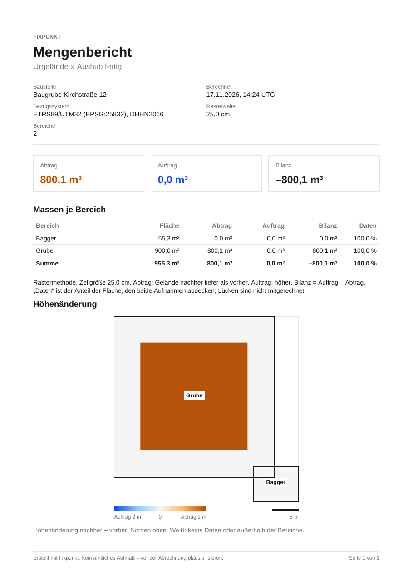

# Aushub berechnen

Der Ablauf für eine Baugrube: **Urgelände fliegen → Aushub fliegen → beide hochladen → Grenzen setzen → berechnen.**

{ width="1440" }
{ width="1440" }

## 1. Aufnahmen hochladen

Im Reiter **Aufnahmen** nimmt **Aufnahme hochladen** eine oder mehrere Dateien: Punktwolken (LAS, LAZ, E57, XYZ, CSV, TXT, PTS) oder
Höhenmodelle (GeoTIFF, ASC). Der Name der Aufnahme kommt aus dem Dateinamen.

Als Datum gilt zunächst der Zeitpunkt des Hochladens. Zeitreihe, Überblick, Vorauswahl der Berechnung und die
Zeiträume der Abrechnung ordnen nach diesem Datum – bei Flügen, die erst später hochgeladen werden, in der
Spalte **Aufnahme vom** das **Flugdatum** eintragen. Bei [Drohnenfotos](drohnenfotos.md) trägt man es schon
vor dem Auswerten ein.

Große Dateien laden in Stücken hoch. Reißt die Verbindung ab – Funkloch auf der Baustelle, WLAN gewechselt –,
macht Fixpunkt von selbst weiter, wo es aufgehört hat. Wird die Seite zwischendurch geschlossen, dieselbe Datei
einfach noch einmal wählen: der Upload setzt fort, statt von vorn zu beginnen. Unfertige Uploads verwirft der
Server nach einer Woche.

Nach dem Hochladen prüft Fixpunkt jede Datei im Hintergrund – Status **Wird geprüft**, dann **Bereit** mit Anzahl
der Punkte. Eine Datei, die sich nicht lesen lässt, steht auf **Fehlgeschlagen** mit dem Grund. Die Liste
aktualisiert sich von selbst, auch für Kolleginnen und Kollegen, die die Baustelle gerade offen haben.

> [!TIP]
> Aus OpenDroneMap: die georeferenzierte Punktwolke `odm_georeferencing/odm_georeferenced_model.laz` oder das
> Geländemodell `odm_dem/dtm.tif`. Mehr unter [Daten vorbereiten](daten.md).

## 2. Abrechnungsgrenzen

Bereiche stehen im Reiter **Massen**. Sie lassen sich direkt in der [Ansicht](ansicht.md#bereiche-zeichnen)
zeichnen oder als GeoJSON hochladen: **Grenze hochladen** nimmt eine GeoJSON-Datei. Jedes Polygon darin wird ein eigener Bereich, mit dem Namen aus
der Eigenschaft `name` (oder `Bezeichnung`, `id`). So lässt sich eine Baugrube in Abschnitte teilen, die einzeln
abgerechnet werden. Ohne Bereich rechnet Fixpunkt über die ganze Überlappung der beiden Aufnahmen.

### Material und Massenziel

Das Zielscheiben-Symbol neben einem Bereich legt fest, **welches Material** dort ansteht (frei, mit Vorschlägen
wie „Oberboden“ oder „Boden Klasse 4“) und **wie viel** bewegt werden soll – als Abtrag oder Auftrag in m³. Der
[Überblick](erste-schritte.md#überblick-einer-baustelle) zeigt dann je Bereich, wie viel davon laut der neuesten
Aushub-Berechnung gegen das Urgelände geschafft ist, was offen ist, und die Summen je Material.

Ein Bereich um eine Halde wird mit **Zählt → Lager (Haufwerk)** zum Lager für sein Material, ohne Soll-Menge. Der
Bestand kommt aus der [Haufwerk-Berechnung](berechnungen.md#haufwerk) je Befliegung (je Aufnahme die neueste). Der
Überblick zeigt unter **Bestand je Material** die Summe der Lager, die Änderung zur Befliegung davor und den Stand
– etwa „Oberboden 420 m³, +40 m³“ –, darunter den **Verlauf je Material** über alle Befliegungen. Ein Lager
ohne neue Messung zählt im Verlauf mit seinem letzten Wert. Abtrag in der Grube und Bestand auf der Halde werden bewusst nicht
gegeneinander gerechnet: gelöster Boden nimmt auf der Halde etwa 10–30 % mehr Raum ein.

Im selben Formular stehen **LV-Position, Einheitspreis und Preiseinheit** für das Aufmaß; mehr unter
[Abrechnung](abrechnung.md).

## 3. Berechnen

Im Reiter **Massen** unter **Berechnungen**:

- **Urgelände (vorher)** und **Nach dem Aushub** wählen – vorausgewählt sind die älteste und die jüngste Aufnahme.
- **Rasterweite:** 25 cm passt für Drohnenflüge; 10 cm für sehr dichte Wolken, 50 cm–1 m für schnelle Übersichten.
- **Bagger, Container und Bewuchs herausfiltern:** an lassen, außer die Aufnahme ist schon ein reines Geländemodell (DTM).
- **Abrechnungsbereiche** an- oder abwählen.

**Aushub berechnen** reiht die Berechnung ein; sie läuft im Hintergrund, die Liste zeigt den Stand.

## 4. Mengenbericht

{ width="1440" height="900" }
{ width="1440" height="900" }

| Wert | Bedeutung |
|---|---|
| **Abtrag** | Volumen, um das das Gelände tiefer liegt als vorher (Aushub) |
| **Auftrag** | Volumen, um das es höher liegt (Anschüttung, Haufwerk) |
| **Bilanz** | Auftrag − Abtrag; bei reinem Aushub negativ |
| **Fläche** | Fläche des Abrechnungsbereichs |

Fehlen in einem Bereich für mehr als 5 % der Fläche Daten, warnt der Bericht: diese Stellen sind **nicht**
mitgerechnet. Meist deckt dann eine der Aufnahmen den Bereich nicht ganz ab.

Weitergeben:

- **PDF-Bericht** – eine Seite A4 für Bauleitung und Büro, siehe unten
- **Als CSV** – Tabelle für Excel (Semikolon, Dezimalkomma)
- **Differenzraster (GeoTIFF)** – Höhenänderung je Rasterzelle, zum Ansehen in QGIS oder im CAD
- **Drucken** – die Seite über den Druckdialog des Browsers

### PDF-Bericht

Der Server erzeugt den Bericht selbst, unabhängig vom Browser: Kopf mit Baustelle, Zeitpunkt der Berechnung,
Bezugssystem und Rasterweite, die Kennzahlen, die Tabelle je Bereich mit dem Anteil der Fläche, für den beide
Aufnahmen Daten haben, und eine Karte der Höhenänderung mit den Abrechnungsbereichen, Farbskala und
Maßstabsleiste. Fehlen Daten, steht die Warnung auch im PDF.

[{ width="910" height="1287" loading="lazy" }](beispiel-mengenbericht.pdf)

[Beispiel herunterladen (PDF)](beispiel-mengenbericht.pdf). Haufwerk, Soll/Ist und Zeitreihe haben denselben
Knopf; der Soll/Ist-Bericht zeigt zusätzlich Kennwerte, Restmassen, die Verteilung und eine Karte der
Abweichung. Der PDF-Bericht ist vorerst nur auf Deutsch.

Haufwerke, Soll/Ist-Vergleiche, Zeitreihen, Exporte und Passpunkte stehen unter
[Haufwerk, Soll/Ist, Zeitreihe, Export, Passpunkte](berechnungen.md).

> [!WARNING]
> Für die Abrechnung den Bericht mit Lieferscheinen, LKW-Ladungen oder einem Aufmaß plausibilisieren, bis die
> Genauigkeit auf euren Baustellen belegt ist ([Methode und Genauigkeit](methode.md)).
