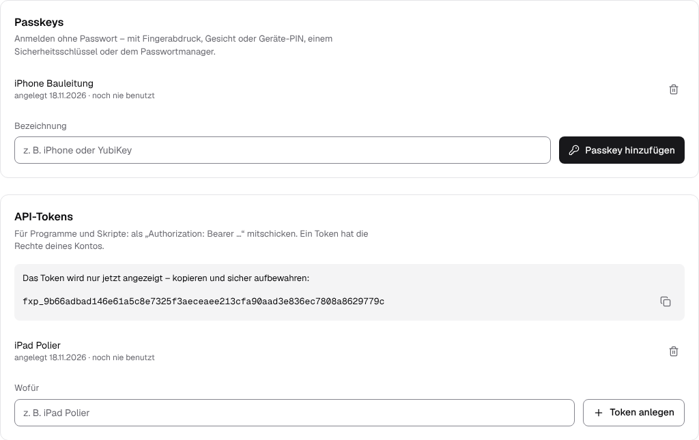

# Benutzer und Rollen

| Rolle | darf |
|---|---|
| **Admin** | alles, dazu Benutzer anlegen und löschen |
| **Bearbeiten** | Baustellen, Aufnahmen, Bereiche, Berechnungen, Abrechnung, Pläne und Dokumentation anlegen, ändern, löschen; Drohnenfotos auswerten, Aufmaß zur Freigabe senden |
| **Nur lesen** | alles ansehen und herunterladen, z. B. für Bauherr oder Prüfer |

Admins legen Zugänge unter **Benutzer** an: Name, erstes Passwort, Rolle. Das erste Passwort am besten persönlich
weitergeben; geändert wird es unter **Konto**. Der letzte Admin lässt sich nicht löschen.

Unter **Konto** verwaltet jeder sein eigenes Konto – auch mit der Rolle „Nur lesen“: Passwort, Passkeys und
API-Tokens.



## Passkeys

Mit einem Passkey meldet man sich ohne Passwort an: per Fingerabdruck, Gesicht oder Geräte-PIN, mit einem
Sicherheitsschlüssel oder über den Passwortmanager des Geräts.

1. Unter **Konto → Passkeys** eine Bezeichnung eingeben (z. B. „iPhone“) und **Passkey hinzufügen**.
2. Beim nächsten Mal auf der Anmeldeseite den Namen eingeben und **Mit Passkey anmelden**.

Passkeys brauchen die öffentliche Adresse des Servers: `FIXPUNKT_PUBLIC_URL=https://fixpunkt.example.de`
([Konfiguration](konfiguration.md)). Ein Passkey gilt nur für genau diese Domain; außer `localhost` verlangen die
Browser HTTPS. Ohne die Einstellung fehlt der Abschnitt, und es bleibt beim Passwort. Das Passwort gilt auch mit
Passkey weiter.

## API-Tokens

Für Programme und Skripte (später die iOS-App) gibt es Tokens statt Passwort:

1. Unter **Konto → API-Tokens** einen Zweck eingeben und **Token anlegen**.
2. Das Token (`fxp_…`) erscheint **nur dieses eine Mal** – kopieren und sicher aufbewahren.
3. Bei jeder Anfrage mitschicken:

```sh
curl -H "Authorization: Bearer fxp_…" https://fixpunkt.example.de/api/sites
```

Ein Token hat die Rolle seines Benutzers (ein Leser-Token darf nur lesen) und braucht kein CSRF-Token. Tokens und
Passkeys verwalten lässt sich nur mit einer echten Anmeldung, nicht mit einem Token. Ein gelöschtes Token gilt
sofort nicht mehr; die Liste zeigt, wann jedes zuletzt benutzt wurde.

## Sicherheit

- Passwörter werden mit **argon2id** gespeichert, nie im Klartext.
- Die Sitzung steckt in einem Cookie, das Skripte nicht lesen können (`HttpOnly`, `SameSite=Strict`), hinter HTTPS
  zusätzlich `Secure` (`FIXPUNKT_SECURE_COOKIES=true`).
- Jede ändernde Anfrage trägt ein **CSRF-Token** der Sitzung.
- Falsche Anmeldungen werden gebremst.
- Passkeys prüft [webauthn-rs](https://github.com/kanidm/webauthn-rs) (Signatur, Herkunft, Zähler, Nutzerprüfung);
  gespeichert ist nur der öffentliche Schlüssel.
- Von API-Tokens speichert der Server nur den SHA-256.
