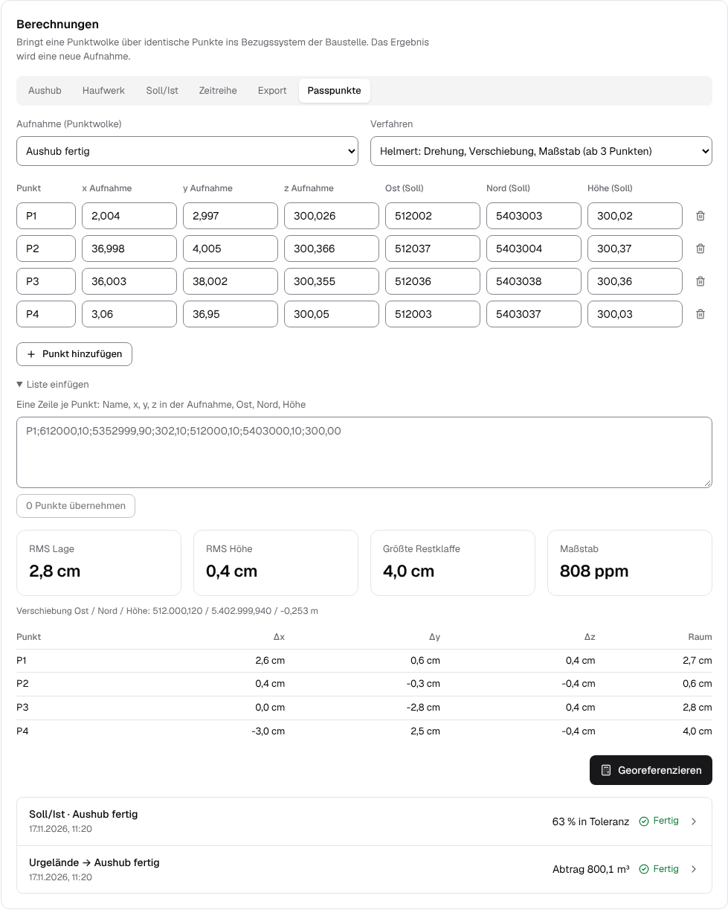

# Haufwerk, Soll/Ist, Zeitreihe, Export

Neben dem [Aushub](aushub.md) rechnet Fixpunkt im Reiter **Massen** unter **Berechnungen** vier weitere Arten. Die Art wählt man oben
im Bereich; jede hat ihr eigenes Formular, das Ergebnis öffnet sich aus der Liste darunter.

## Haufwerk

Volumen eines Haufens (Oberboden-Miete, Schotter, Aushub-Zwischenlager) aus **einer** Aufnahme:

1. Um jeden Haufen einen Bereich legen – die Grenze knapp außerhalb des Haufenfußes.
2. **Haufwerk**, Aufnahme und Bereiche wählen.
3. **Basisfläche:**
    - *Ebene durch die Grenze* – Ausgleichsebene durch die Geländehöhen entlang der Grenze; richtig für Haufen
      auf geneigtem Gelände
    - *Tiefster Punkt der Grenze* – waagrechte Basis; rechnet eher zu viel
    - *Feste Höhe* – z. B. die bekannte Höhe einer Lagerfläche

Der Bericht zeigt je Bereich das **Volumen** über der Basis und, falls vorhanden, was darunter liegt
(Mulden, Fahrspuren).

> [!TIP]
> Den Bodenfilter beim Haufwerk ausschalten: er würde den Haufen sonst teilweise als „Objekt“ abtragen.

## Soll/Ist

Prüft, ob die Sohle, ein Planum oder eine Böschung stimmt:

{ width="1440" height="900" }
{ width="1440" height="900" }

| Soll | Eingabe |
|---|---|
| **Waagrechte Sohle** | Sollhöhe in m (z. B. 296,40) |
| **Geneigte Ebene** | Bezugspunkt (Ost-, Nordwert, Höhe), Gefälle in %, Richtung, in die sie fällt (0° = Nord, 90° = Ost) |
| **Soll-Geländemodell** | eine zweite Aufnahme, z. B. das Planungs-DGM als GeoTIFF |

Dazu einen **Bereich** (am besten nur die Sohle, nicht den Grubenrand) und die **Toleranz** in cm.

Der Bericht zeigt den Anteil der Fläche **in Toleranz**, **zu hoch** und **zu tief**, die Verteilung der
Abweichung und die **Restmassen**: was noch abzutragen und was aufzufüllen ist. Das Abweichungsraster
(GeoTIFF) zeigt in QGIS, *wo* nachgearbeitet werden muss. Der **PDF-Bericht** fasst alles zusammen, mit
einer Karte der Abweichung (orange: zu hoch, blau: zu tief).

## Zeitreihe

Fortschritt über die Bauphase: jede Aufnahme gegen das Urgelände und gegen die vorige. Fixpunkt ordnet die
Aufnahmen nach ihrem Datum, die älteste ist das Urgelände. Der Bericht zeigt je Befliegung den Abtrag seit Beginn
und seit der letzten Befliegung – passend zu Abschlagsrechnungen.

## Export

Für CAD und Vermessung aus einer Aufnahme, optional nur innerhalb von Bereichen:

| Format | Inhalt |
|---|---|
| Höhenmodell (GeoTIFF) | Raster mit EPSG-Code, für QGIS und GIS |
| Höhenlinien und Grenzen (DXF) | Haupt- und Zwischenlinien im gewählten Abstand, Bereichsgrenzen |
| Oberfläche als TIN (LandXML) | für Civil-Programme (Civil 3D, Card/1, BricsCAD) |
| Rasterpunkte (CSV) | `x;y;z` |
| Dreiecksnetz (OBJ) | für 3D-Programme, relativ zu einem Bezugspunkt |
| Orthofoto (GeoTIFF) | das [Orthofoto](ansicht.md#orthofoto) der Aufnahme in voller Auflösung (höchstens 8192 Pixel je Seite), RGBA, auf die gewählten Bereiche zugeschnitten und außerhalb durchsichtig; nur wählbar, wenn die Aufnahme eins hat |

Große Flächen werden für LandXML, CSV und OBJ ausgedünnt (höchstens 250.000 Punkte), damit CAD-Programme sie
öffnen. Alle Dateien liegen im Koordinatensystem der Baustelle (EPSG:25832) – das Orthofoto bleibt in dem seiner
Quelle, falls es aus einer anderen UTM-Zone stammt (die Bereiche werden dafür umgerechnet).

## Passpunkte

Liegt eine Punktwolke nicht im Bezugssystem der Baustelle – ein Scan im lokalen System, ein Flug ohne RTK –,
bringen identische Punkte sie dorthin: Punkte, die in der Aufnahme zu sehen sind und deren Sollkoordinaten
bekannt sind (Passpunktplatten, Kanaldeckel, Bolzen, vom Vermesser eingemessen).

{ width="979" height="1223" loading="lazy" }

1. **Berechnungen → Passpunkte** und die Aufnahme wählen.
2. Je Punkt die Koordinate in der Aufnahme (in der [Ansicht](ansicht.md) mit **Punkt** messen) und die
   Sollkoordinate eintragen – oder unter **Liste einfügen** aus einer Tabelle kopieren: eine Zeile je Punkt mit
   Name, x, y, z in der Aufnahme, Ost, Nord, Höhe (wie `fixpunkt georef --gcp`).
3. Die **Vorschau** rechnet sofort: Verschiebung, Maßstab und die **Restklaffen** je Punkt. Fällt ein Punkt aus
   der Reihe, ist er vermutlich falsch zugeordnet – korrigieren oder entfernen.
4. **Georeferenzieren** legt die Aufnahme ein zweites Mal an, transformiert und neu geprüft
   („… (georeferenziert)“). Die ursprüngliche bleibt unverändert.

| Verfahren | Bestimmt | Punkte |
|---|---|---|
| Helmert | Drehung, Verschiebung, Maßstab (7 Parameter) | ab 3, besser 4–6 gut verteilte |
| Drehung und Verschiebung | wie Helmert, Maßstab fest 1 | ab 3 |
| Nur Verschiebung | 3 Parameter, z. B. für einen konstanten Höhenfehler | ab 1 |

> [!TIP]
> Passpunkte über die ganze Fläche verteilen, nicht in einer Reihe, und mindestens einen mehr als nötig
> nehmen – nur dann zeigen die Restklaffen, ob alles passt. Gerechnet wird nach Umeyama (kleinste Quadrate über
> alle Punkte), siehe [Methode und Genauigkeit](methode.md).
