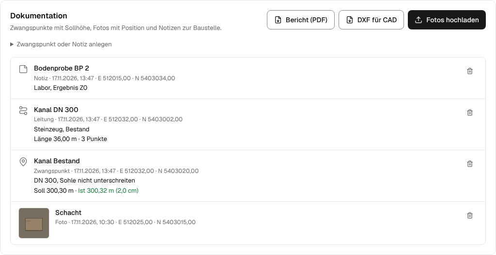
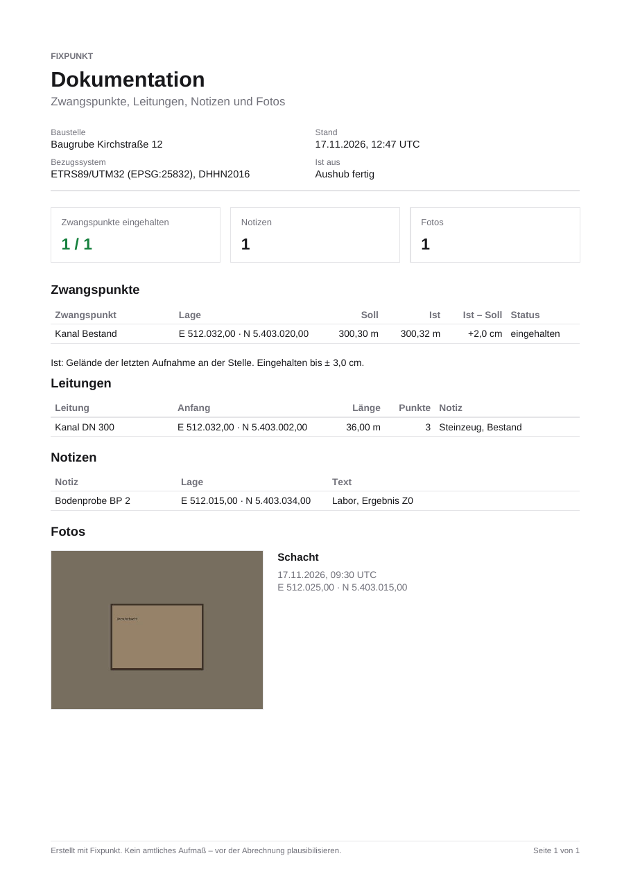

# Dokumentation

Unter **Dokumentation** auf der Seite einer Baustelle sammelt Fixpunkt, was neben den Massen festgehalten werden
muss: Zwangspunkte, Leitungen, Fotos und Notizen. Alles mit Lage erscheint auch in der [Ansicht](ansicht.md) –
Zwangspunkte als Raute, Fotos und Notizen als Punkt, Leitungen als Linie.

{ width="1024" height="528" loading="lazy" }

## Zwangspunkte

Ein Zwangspunkt ist eine Höhe, die eingehalten werden muss – die Sohle eines Bestandskanals, ein Anschluss, eine
Gründungshöhe. Fixpunkt vergleicht die **Sollhöhe** mit dem Gelände der neuesten Aufnahme an dieser Stelle und
zeigt **Ist** und den Unterschied: grün bis 3 cm, sonst in Warnfarbe.

**Zwangspunkt oder Notiz anlegen** → Bezeichnung, Ost, Nord und Sollhöhe (DHHN2016). Die Koordinaten einer
Stelle liefert die [Ansicht](ansicht.md) mit **Punkt**.

## Leitungen

Den Verlauf einer Leitung zeichnet man in der [Ansicht](ansicht.md#leitungen-zeichnen) nach: **Leitung zeichnen**,
die Punkte entlang der Leitung anklicken, Name und Notiz (Material, Durchmesser) eingeben, **Leitung speichern**.
Jeder Punkt bekommt die Höhe des Geländes der gezeigten Aufnahme darunter – im offenen Graben also die Höhe, auf
der die Leitung liegt. In der Liste stehen Länge und Zahl der Punkte.

## Fotos

**Fotos hochladen** nimmt eines oder mehrere Fotos (JPG, PNG). Hat ein Foto eine GPS-Position – Handys und
Drohnen speichern sie im Foto (EXIF) –, rechnet Fixpunkt sie in das Bezugssystem der Baustelle um und zeigt das
Foto an seiner Stelle; die Aufnahmezeit kommt ebenfalls aus dem Foto. Ein Klick auf das Vorschaubild öffnet das
Original.

> [!NOTE]
> Handy-GPS ist auf einige Meter genau – gut genug, um ein Foto wiederzufinden, nicht zum Messen. Ohne GPS-Position
> steht das Foto nur in der Liste.

## Notizen

Notizen halten fest, was sonst im Bautagebuch verschwindet: Bodenproben, Abstimmungen, Fundstellen. Ost und Nord
sind freiwillig; mit Lage stehen sie in der Ansicht.

## Bericht (PDF)

**Bericht (PDF)** oben im Abschnitt fasst die Dokumentation einer Baustelle zusammen: alle Zwangspunkte mit Lage,
Sollhöhe, Gelände der letzten Aufnahme, Abweichung und Status (eingehalten bis ± 3 cm), die Notizen als Tabelle
und jedes Foto mit Aufnahmezeit, Lage und Notiz. Lesern steht der Bericht genauso zur Verfügung.

[{ width="910" height="1263" loading="lazy" }](beispiel-dokumentation.pdf)

[Beispiel herunterladen (PDF)](beispiel-dokumentation.pdf)

## DXF für CAD

**DXF für CAD** lädt die ganze Dokumentation als Zeichnung (DXF R12) herunter, zum Weiterzeichnen in AutoCAD,
BricsCAD oder QGIS – etwa als Grundlage für den Bestandsplan. Jede Art liegt auf einer eigenen Ebene:

| Ebene | Inhalt |
|---|---|
| `FP_LEITUNGEN` | Leitungen als 3D-Polylinie, Name am Anfang |
| `FP_ZWANGSPUNKTE` | Punkt mit Sollhöhe als z, Beschriftung „Name Sollhöhe“ |
| `FP_NOTIZEN` | Punkt und Titel |
| `FP_FOTOS` | Punkt und Titel |

Koordinaten im Bezugssystem der Baustelle (ETRS89/UTM32, Höhen DHHN2016), ohne Zonenkennung im Ostwert.
Punkte einer Leitung ohne Gelände darunter übernehmen die Höhe des Punkts davor.
