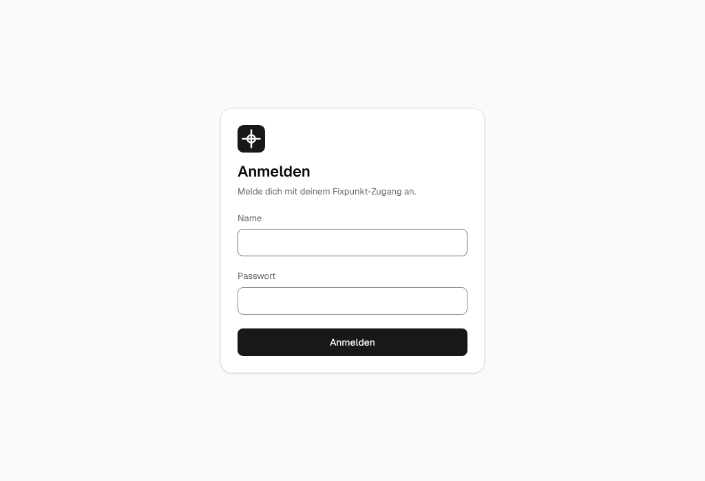
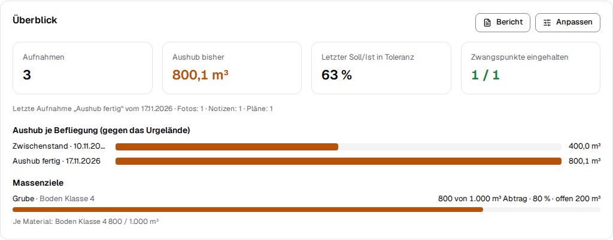
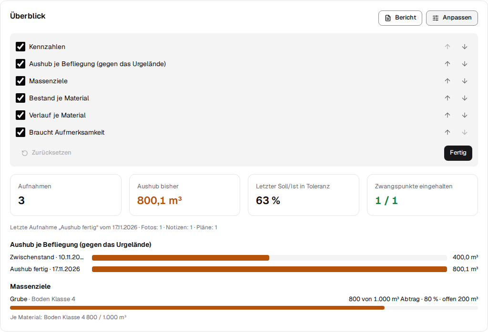
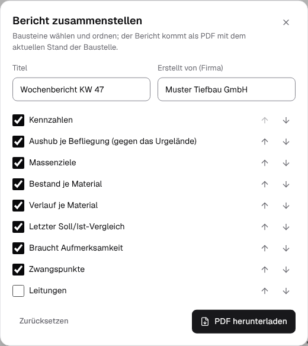
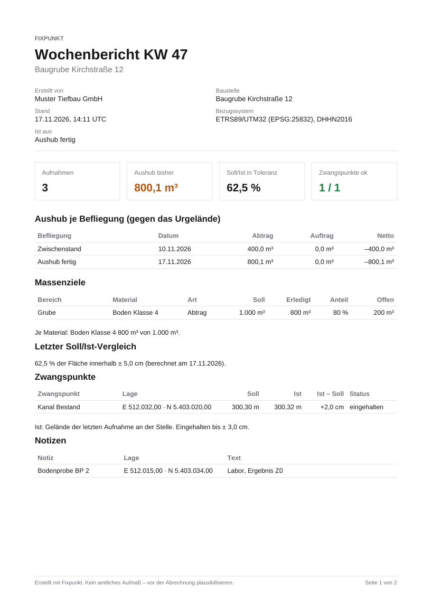

# Erste Schritte

## Einrichten und anmelden

Beim allerersten Aufruf legt man den Admin-Zugang an. Danach meldet sich jeder mit Name und Passwort an; die
Sitzung hält 30 Tage.

{ width="1024" height="700" }

## Baustelle anlegen

Unter **Baustellen → Neue Baustelle** einen Namen und optional eine Beschreibung eingeben (z. B. „Neubau MFH mit
Tiefgarage · Aushub bis −2,0 m“). Eine Baustelle sammelt alles, was zu ihr gehört: Aufnahmen, Abrechnungsbereiche
und Berechnungen.

Über der Liste zeigt eine **Karte**, wo die Baustellen liegen. Die Lage ergibt sich von selbst aus den geprüften
Aufnahmen (oder, solange es keine gibt, aus den Abrechnungsbereichen); ein Klick auf einen Punkt öffnet die
Baustelle. Den Kartenhintergrund liefert OpenStreetMap, ein eigener Kachelserver oder keiner
([Konfiguration](konfiguration.md)).

{ width="1440" height="900" }
{ width="1440" height="900" }

## Überblick einer Baustelle

Oben auf der Seite einer Baustelle steht, sobald es eine Aufnahme gibt, der **Überblick**:

- **Aufnahmen** und wann zuletzt geflogen wurde, dazu Fotos, Notizen und Pläne;
- **Aushub bisher**: der Abtrag der neuesten Aufnahme gegen das Urgelände (die älteste Aufnahme);
- **Letzter Soll/Ist in Toleranz**: der Anteil der Fläche innerhalb der Toleranz beim jüngsten Vergleich;
- **Zwangspunkte eingehalten**: jeder Zwangspunkt mit Höhe wird gegen die letzte Aufnahme geprüft, bis 3 cm
  Abweichung gilt er als eingehalten.

Darunter der **Aushub je Befliegung** als Balken – jede Aushub-Berechnung gegen das Urgelände zählt, je Aufnahme die
neueste. Ein Klick öffnet die Berechnung. Verletzte Zwangspunkte und fehlgeschlagene Berechnungen stehen am Ende
unter „Braucht Aufmerksamkeit“. Der Überblick aktualisiert sich von selbst, sobald eine Berechnung fertig ist.

Haben Bereiche ein [Massenziel](aushub.md#material-und-massenziel), stehen sie unter **Massenziele**: erledigt
von Soll in m³, Prozent und offen, dazu die Summe je Material. Gezählt wird die neueste Aushub-Berechnung gegen
das Urgelände, die den Bereich enthält. Lager (Haufwerk-Bereiche) stehen unter **Bestand je Material**: Menge
der neuesten Haufwerk-Berechnung, Änderung zur Befliegung davor und Stand, darunter der Verlauf je Material.

### Überblick anpassen

**Anpassen** oben rechts zeigt alle Abschnitte des Überblicks: Häkchen blenden einen Abschnitt ein oder aus, die
Pfeile verschieben ihn. Das gilt für dich und diese Baustelle – jeder im Team stellt sich seinen Überblick selbst
zusammen, auch mit der Rolle „Nur lesen“. Gespeichert wird sofort; **Zurücksetzen** stellt die Grundeinstellung
wieder her.

### Bericht zusammenstellen

**Bericht** oben im Überblick stellt einen eigenen PDF-Bericht der Baustelle zusammen: Titel (z. B.
„Wochenbericht KW 47“), optional die Firma, die ihn erstellt, und die Bausteine in beliebiger Reihenfolge –
Kennzahlen, Aushub je Befliegung, Massenziele, Lagerbestand und Verlauf je Material, letzter Soll/Ist-Vergleich,
was Aufmerksamkeit braucht, Zwangspunkte, Leitungen, Notizen und Fotos. Der Bericht zeigt den Stand beim
Herunterladen; die Auswahl merkt sich der Browser für das nächste Mal.

[{ width="910" height="1287" loading="lazy" }](beispiel-baustellenbericht.pdf)

[Beispiel herunterladen (PDF)](beispiel-baustellenbericht.pdf)

Weiter geht es mit [Aushub berechnen](aushub.md).

## Sprache und Farbschema

Unter **Konto** lassen sich Sprache (Deutsch, Englisch) und Farbschema (hell, dunkel, wie das Gerät) wählen; beides
gilt für dieses Gerät. Ohne Wahl folgt Fixpunkt der Sprache des Browsers und dem Farbschema des Geräts. Dort
ändert man auch das eigene Passwort.

## Am Tablet oder Handy

Fixpunkt ist eine installierbare Web-App: im Browser „Zum Startbildschirm hinzufügen“ bzw. „App installieren“.
Seiten und Berichte passen sich an kleine Bildschirme an.
