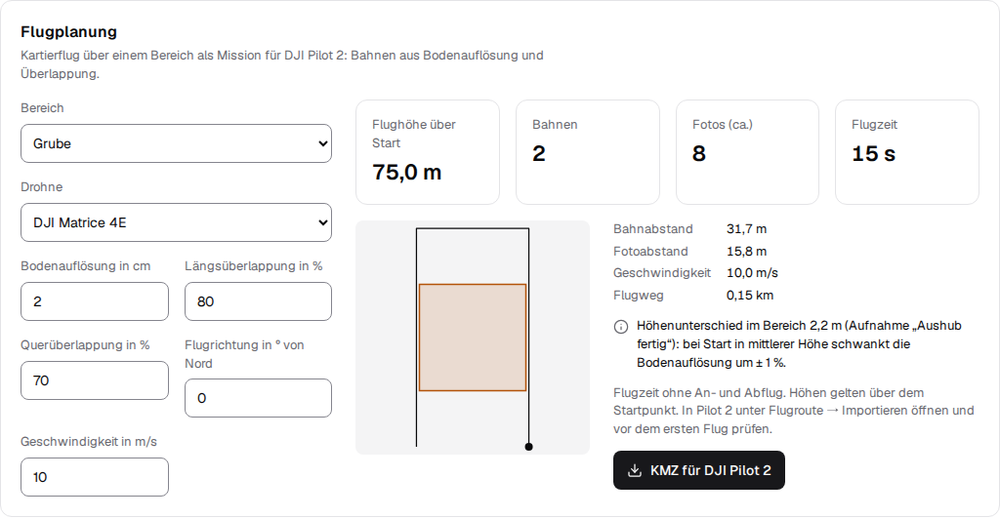

# Flugplanung

Im Reiter **Aufnahmen** einer Baustelle, Abschnitt **Flugplanung** (aufklappen), entsteht aus einem Abrechnungsbereich eine Kartiermission für
DJI Pilot 2. Die Drohne fliegt parallele Bahnen (Rasenmäher-Muster) mit senkrecht nach unten gerichteter Kamera und
löst auf jeder Bahn in festem Abstand aus. Die Fotos gehen danach wie gewohnt an
[NodeODM](drohnenfotos.md).



## Einstellungen

| Feld | Vorgabe | Bedeutung |
|---|---|---|
| Bereich | erster Bereich | Fläche, die vollständig abgebildet wird |
| Drohne | Matrice 4E | Kamera und Gerätekennung in der Mission |
| Bodenauflösung | 2 cm | Größe eines Pixels am Boden (GSD); bestimmt die Flughöhe |
| Längsüberlappung | 80 % | Überlappung aufeinanderfolgender Fotos auf einer Bahn |
| Querüberlappung | 70 % | Überlappung benachbarter Bahnen |
| Flugrichtung | 0° | Richtung der Bahnen, im Uhrzeigersinn von Nord (90° = Ost–West) |
| Geschwindigkeit | 10 m/s | wird verringert, wenn die Kamera sonst nicht schnell genug auslöst |

Für Massen genügen 2 cm Bodenauflösung mit 80/70 % Überlappung (siehe [Methode](methode.md)). Bei Bewuchs oder
steilen Böschungen hilft mehr Überlappung (85/75 %).

## Rechnung

Mit Sensorbreite *s*, Brennweite *f* und Bildbreite *B* (Pixel) der Kamera:

- **Flughöhe** H = GSD · *f* · *B* / *s*. Für die Matrice 4E (4/3-Sensor 17,3 × 13 mm, 12,29 mm, 5280 × 3956 Pixel)
  ist das H ≈ 37,5 · GSD: 2 cm → 75 m.
- **Bahnabstand** = GSD · 5280 · (1 − Querüberlappung): 2 cm, 70 % → 31,7 m.
- **Fotoabstand** = GSD · 3956 · (1 − Längsüberlappung): 2 cm, 80 % → 15,8 m. Die lange Bildseite liegt quer zur
  Flugrichtung.
- **Geschwindigkeit** höchstens Fotoabstand / 0,7 s (kürzestes Auslöseintervall).

Die Bahnen liegen mittig über dem Bereich, die äußeren auf oder jenseits der Grenze; jede Bahn beginnt und endet
einen Fotoabstand außerhalb, damit auch die Ränder in voller Überlappung abgebildet sind. Bei unregelmäßigen
Bereichen folgt die Länge jeder Bahn dem Umriss.

## Höhe und Gelände

Pilot 2 fliegt die Höhe **über dem Startpunkt**. Gibt es schon eine Aufnahme, zeigt Fixpunkt den Höhenunterschied
im Bereich und wie stark die Bodenauflösung deshalb schwankt; ab ± 10 % erscheint eine Warnung. Am besten in
mittlerer Höhe des Geländes starten, nicht auf der Grubensohle.

## In Pilot 2 öffnen

1. **KMZ für DJI Pilot 2** herunterladen und auf die Fernsteuerung kopieren (USB, microSD oder Cloud-Laufwerk).
2. In Pilot 2 **Flugroute → Importieren** und die Datei wählen.
3. Route, Höhe und Rückkehrhöhe in Pilot 2 prüfen und dann fliegen.

Die Datei folgt dem DJI-Format WPML: `wpmz/template.kml` (zum Bearbeiten in Pilot 2) und `wpmz/waylines.wpml`
(was die Drohne ausführt). Je Bahn gibt es zwei Wegpunkte. Am ersten Wegpunkt schwenkt die Kamera auf −90°, auf
jeder Bahn löst sie über `multipleDistance` aus. Nach dem letzten Wegpunkt kehrt die Drohne zurück
(`goHome`), bei Verbindungsverlust ebenso.

!!! warning "Vor dem ersten Flug prüfen"
    Die Gerätekennung der Matrice 4E (99/0, Kamera 88) steht nicht in der öffentlichen Produktliste der
    DJI Cloud API. Lehnt Pilot 2 die Datei ab, als Drohne „Mavic 3 Enterprise“ wählen (77/0, Kamera 66, laut
    Produktliste) oder die Route einmal in Pilot 2 anlegen und mit den Bahnen aus der Vorschau vergleichen.

## API

```
GET /api/regions/{id}/flightplan?gsd=2&front=80&side=70&direction=0&speed=10&drone=m4e
GET /api/regions/{id}/flightplan.kmz?…
```

Die erste Abfrage liefert Bahnen (UTM), Kennzahlen und den Höhenbereich der letzten Aufnahme als JSON, die zweite
die Mission.
