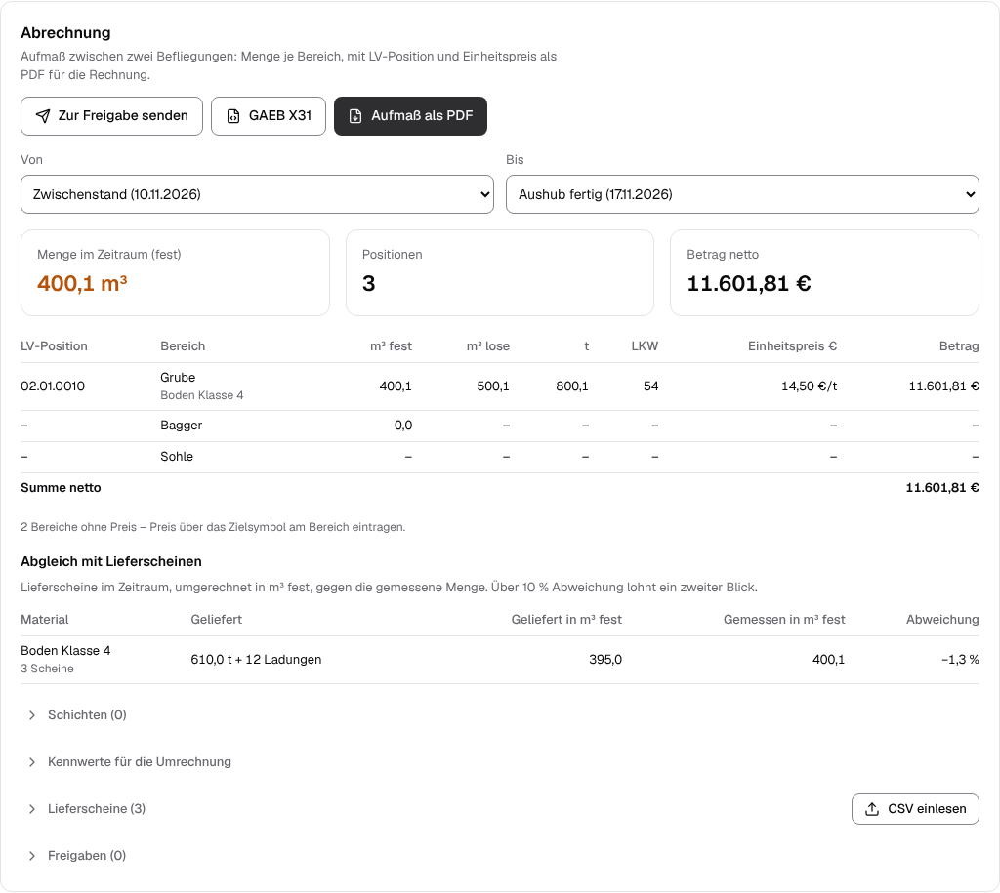
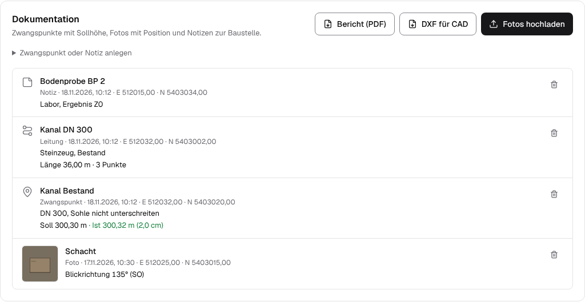

<!-- Die Seite zum Weitergeben: was Fixpunkt kann, in Bildern. Die Bilder entstehen mit
     bun run docs:screenshots (entwicklung.md). Aufbau wie firsttris/haben docs/index.md. -->

Baustellendokumentation, selbst gehostet

# Der Aushub in m³, am Tag des Flugs.

Drohne fliegt, OpenDroneMap rechnet die Punktwolke, Fixpunkt vergleicht sie mit dem
Urgelände und liefert die Massen je Abrechnungsbereich – mit Bagger und Bewuchs herausgerechnet. Auf deinem
Server, als eine einzige Programmdatei.

[Rundgang starten](#rundgang){ .md-button .md-button--primary } [Installieren](installation.md){ .md-button } [So wird gerechnet](methode.md){ .md-button }

Fixpunkt ist in der ersten Phase: vor der Abrechnung mit Lieferscheinen oder Aufmaß plausibilisieren.

{ width="1440" height="900" }
{ width="1440" height="900" }

Baustellen

## Jede Baustelle mit ihren Flügen

Für jede Baustelle sammelt Fixpunkt die Aufnahmen über die ganze Bauphase: Urgelände, Zwischenstände,
Endzustand. Auf einen Blick, wie viele Flüge es gibt und wann zuletzt geflogen wurde.

[Erste Schritte](erste-schritte.md)

{ width="1440" height="900" loading="lazy" }
{ width="1440" height="900" loading="lazy" }

Massen

## Bereiche festlegen, Stände vergleichen

Punktwolken als LAS, LAZ, E57 oder XYZ, Höhenmodelle als GeoTIFF – direkt aus OpenDroneMap. Die
Abrechnungsgrenzen kommen als GeoJSON aus QGIS oder werden im Browser gezeichnet. Im Reiter „Massen“ stehen
alle Berechnungen der Baustelle: Aushub, Haufwerk, Soll/Ist, Zeitreihe, Export und Passpunkte.

[Aushub berechnen](aushub.md)

{ width="1440" loading="lazy" }
{ width="1440" loading="lazy" }

Mengenbericht

## Abtrag, Auftrag, Bilanz – je Bereich

Zwei Aufnahmen auswählen, „Aushub berechnen“, fertig. Der Bericht zeigt die Massen je Abrechnungsbereich,
warnt bei Lücken in den Daten und geht als PDF mit Karte, als CSV oder Differenzraster (GeoTIFF) an Bauleitung und Büro.

[Aushub berechnen](aushub.md)

{ width="1440" height="900" loading="lazy" }
{ width="1440" height="900" loading="lazy" }

Ansicht und Messen

## Messen und zeichnen, ohne QGIS

Das Höhenbild jeder Aufnahme mit der Differenz oder der Soll/Ist-Abweichung darüber. Strecken, Gefälle,
Flächen und Profile direkt im Bild messen, Abrechnungsbereiche einfach anklicken – mit Maus oder Tastatur.

[Ansicht und Messen](ansicht.md)

{ width="1440" height="900" loading="lazy" }
{ width="1440" height="900" loading="lazy" }

Abrechnung

## Aufmaß je Zeitraum, mit Preis und Lieferscheinen

Die Mengen zwischen zwei Flügen je LV-Position, in m³ fest und lose, Tonnen und LKW-Fahrten, gegen die
Lieferscheine gerechnet. Das Aufmaß geht als PDF oder GAEB X31 in die Abrechnung; der Auftraggeber gibt es
per Link frei.

[Abrechnung](abrechnung.md)

{ loading="lazy" }

Dokumentation

## Fotos, Zwangspunkte und Leitungen am richtigen Ort

Fotos mit GPS-Position, Zwangspunkte mit Soll- und Isthöhe, nachgezeichnete Leitungen und Notizen liegen
dort, wo sie hingehören – dazu DXF-Pläne als Hintergrund. Für die Akte als PDF, fürs CAD als DXF.

[Dokumentation](dokumentation.md)

{ loading="lazy" }

Auf der Baustelle

## Am Handy wie am Schreibtisch

Fixpunkt lässt sich auf dem Tablet oder Handy installieren. Der Bericht passt sich an, die Zahlen bleiben
lesbar – auch draußen, hell oder dunkel.

[Benutzer und Rollen](benutzer.md)

{ width="780" height="1688" loading="lazy" }

## Was dahintersteckt

**Bodenfilter**

Bagger, Container und Bewuchs werden aus der Punktwolke entfernt; darunter wird das Gelände ergänzt, wo gemessen wurde.

**Amtliche Koordinaten**

ETRS89/UTM32 (EPSG:25832), Höhen in DHHN2016 über das Quasigeoid GCG2016 – ohne PROJ oder GDAL.

**Eine Programmdatei**

Server, Web-UI und Rechenkern in einer Datei, mit SQLite. Docker-Image für amd64 und arm64.

**Geprüft**

Volumen gegen Kegel- und Pyramidenstumpfformel, 4 Mio. Punkte in Sekunden, Tests auf jeder Schicht.

[Installieren](installation.md){ .md-button .md-button--primary } [Funktionsumfang](funktionen.md){ .md-button } [Quellcode auf GitHub](https://github.com/Speicherstadt/fixpunkt){ .md-button }

