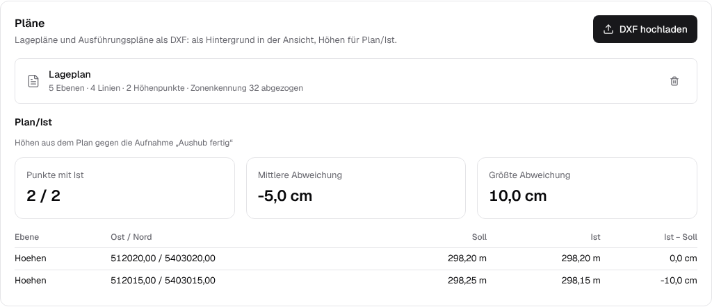
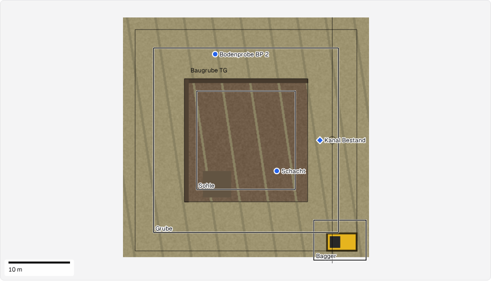

# Pläne

Im Reiter **Dokumentation** einer Baustelle, Abschnitt **Pläne**, lädt man Lage- oder Ausführungspläne als **DXF** hoch. Fixpunkt
liest sie einmal ein und zeigt sie als Strichzeichnung über dem Höhenbild; Höhen aus dem Plan vergleicht es mit
dem gemessenen Gelände.

{ width="1024" height="443" loading="lazy" }

## Was gelesen wird

| Im Plan | In Fixpunkt |
|---|---|
| Linien, Polylinien (auch mit Bögen), Kreise, Bögen | Strichzeichnung |
| Texte und mehrzeilige Texte | Beschriftung, sobald groß genug |
| Punkte mit Höhe, 3D-Polylinien | Höhenpunkte für Plan/Ist |
| Texte, die eine Höhe sind („298,15“, „OK 298,15“, „H=298.2“) | Höhenpunkt an der Stelle des Textes |
| Blöcke (Symbole), Schraffuren, Bemaßungen | bleiben weg |

Der Plan muss im Bezugssystem der Baustelle liegen (ETRS89/UTM32). Ostwerte mit **Zonenkennung** – in
deutschen Plänen üblich, 32 512 000 statt 512 000 – erkennt Fixpunkt und zieht sie ab. Pläne mit lokalen
Baukoordinaten passen nicht; sie lassen sich im CAD vorher transformieren.

## In der Ansicht

In der [Ansicht](ansicht.md) unter **Plan darüber** einen Plan wählen: Er liegt als Strichzeichnung über dem
Höhenbild und der Differenz, zusammen mit Bereichen und Markierungen.

{ width="982" height="563" loading="lazy" }

## Plan/Ist

Enthält ein Plan Höhenpunkte, zeigt Fixpunkt unter **Plan/Ist** für jeden Punkt die Sollhöhe aus dem Plan, das
Gelände der neuesten Aufnahme an dieser Stelle und den Unterschied – dazu, wie viele Punkte gemessen sind, die
mittlere und die größte Abweichung. Für eine ganze Fläche (Sohle, Planum) gibt es den
[Soll/Ist-Vergleich](berechnungen.md#sollist) mit Sollhöhe, geneigter Ebene oder Soll-Geländemodell.

Das Symbol neben einem Plan lädt Plan/Ist als **PDF** herunter: Kennzahlen (Punkte in ± 3 cm, mittlere und größte
Abweichung), alle Höhenpunkte mit Layer, Lage, Soll, Ist und Ist − Soll sowie ein Hinweis auf Punkte außerhalb der
Aufnahme.

> [!TIP]
> Auch die Höhenlinien aus dem [Export](berechnungen.md#export) als DXF lassen sich wieder als Plan einlesen –
> etwa um den Stand einer früheren Befliegung über die aktuelle zu legen.
